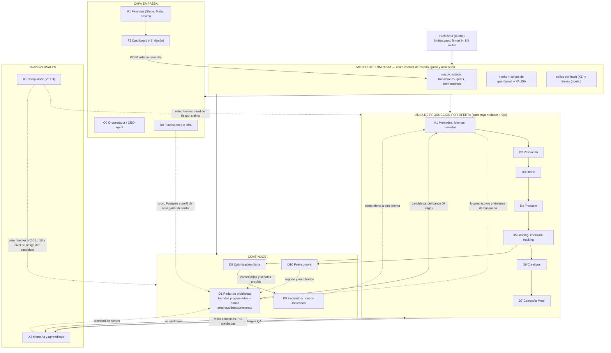
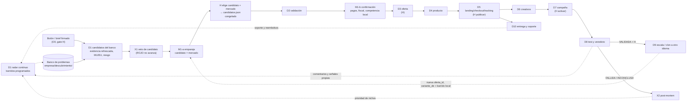
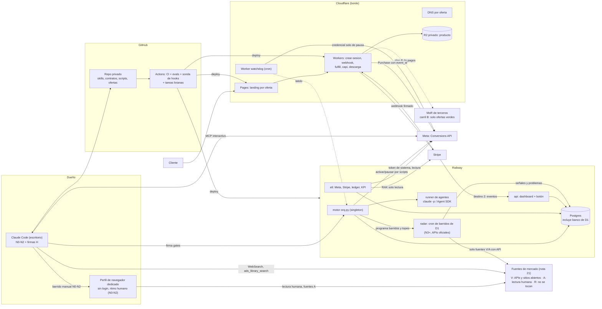

# 02 — Arquitectura del sistema (empresa de agentes para ofertas digitales)

> **Versión:** v1.2 (2026-11-06: adaptada al radar continuo de D1 y a dónde corre, al filtro mecanismo único + entregable único, al marco de los 3 grandes nichos y al riesgo existencial de las dos cuentas únicas) · **Destinatarios:** el dueño (criterio de negocio, técnico moderado) y los agentes futuros.
> **Subordinado a** `docs/_backbone.md` (v2.2), que prevalece ante cualquier contradicción; por debajo mandan los contratos y el código (`docs/contratos.md`, `contratos/*.schema.json`, `contratos/gates.json`, `empresa/limites.yaml`, `empresa/parametros.yaml`, `engine/`): si este documento los contradice, manda el contrato y el conflicto queda en el apéndice de §13. Existen ya `departamentos/16-mercados-localizacion.md` (M1, con su Anexo B: interfaz con el radar) y `docs/contratos.md`. **Verificado el 2026-11-06 a las 09:40: todavía no existen** la reescritura v2-radar de `departamentos/02-descubrimiento.md` (en el árbol sigue la v1 por modos A-D, más el Modo D de modelado en sus §12-17), `docs/_historial/d1-v2-interfaces.md` ni el resumen del piloto del radar (`docs/_historial/d1-v2-piloto/_resumen.md`), ni `empresa/descubrimiento/`, ni un esquema de contrato del banco (`problema`/`senal`/`barrido`; solo `candidatos.schema.json` ya lleva `problema_id`, `macro_nicho` y `locale`). Lo que aquí se dice de D1 sale de backbone §3.2, §5.11 y §9, de las notas 18-21 y 25, del Anexo B de M1 y de `empresa/{limites,parametros}.yaml`, y se marca **[SUPUESTO]** hasta que D1 publique sus nombres (entonces mandan los de D1). Documentos hermanos ya escritos: `docs/04-datos-kpis-dashboard.md` (KPIs, incluido el Radar) y `docs/05-riesgos-guardarrailes.md` (riesgos R10, R14, R18 del radar y guardarraíles). Foco vigente del dueño: las **bases del testeo** (`docs/06-bases-del-testeo.md`); el radar queda fuera de ese plano y se conecta por `candidatos.json`.
> **Etiquetas:** `[VIDEO]` `[CREADORES]` `[NUEVO]` `[DUEÑO]` `[HIPÓTESIS]` `[VERIFICAR]` `[SUPUESTO]`. Las cifras de los creadores son declaraciones de vendedores de cursos (hipótesis). Hechos externos llevan fuente en `docs/_investigacion/` o `[VERIFICAR]`. Lo que sale de Railway, Cloudflare y GitHub (capacidades, límites, precios) **no fue investigado en archivos del proyecto**: todo detalle de plataforma va como `[VERIFICAR]`.

---

## 1. Resumen de una página

**Qué es.** Una empresa de agentes de IA que lanza ofertas de productos digitales de bajo ticket (colecciones PDF, guías, plantillas, patrones) dentro de los **3 grandes nichos —salud, relaciones o dinero—** y en cualquier idioma y mercado donde haya brecha, y las testea con anuncios de Meta hacia una landing propia con checkout de Stripe. Una **oferta** = un concepto × un idioma/clúster de mercados, con su propia marca, dominio, landing, píxel y P&L (backbone §3.1). Los problemas **no los entrega el dueño**: un radar continuo (D1) los busca en el feedback real del mercado y los guarda en un **banco**; el dueño elige entre candidatos con evidencia (decisiones 12 y 13). Meta final: el botón **"Lanzar nueva oferta"**, que elige desde ese banco.

**Cómo funciona.** Cada etapa (D1…D10, más M1 de mercados) la hace un **Maker** especialista con una skill y la revisa un **QA independiente** en contexto limpio. D1 es la excepción de cadencia: **no espera el botón**, corre barridos programados y mantiene el banco (§4.4, §5.6). Entre etapas hay contratos JSON validados por código y un **gate** (A automático, S por excepción, H humano). Encima hay una capa de empresa: **O0** (orquesta y gobierna autonomía), **D0** (infra y topes), **F1** (Finanzas sobre Stripe), **F2** (dashboard y botón), **X1** (compliance con veto) y **X2** (memoria y mejora de skills).

**Principio rector `[NUEVO]`:** *los LLM proponen, el código dispone*. Todo lo que mueve dinero, publica o afecta cumplimiento lo ejecutan scripts y hooks deterministas con topes en `empresa/limites.yaml`; el LLM nunca tiene la última palabra sobre un monto, una activación ni un reembolso.

| Quién | Qué hace | Qué no hace |
|---|---|---|
| **Humano (dueño)** | Fija límites duros y **líneas rojas** (de promesas, contenidos y modelos de negocio, no de temas), firma gates H (elegir candidato del banco —H hasta N3—, aprobar oferta, publicar landing, activar campaña, subir sobre el tope, primer lanzamiento en país/idioma nuevo, capital), decide entidad fiscal, mercados y marca, apela cuentas | No hace trabajo operativo repetitivo; revisa por excepción cuando sube la autonomía |
| **Código determinista** (motor, scripts, hooks, ETL) | Estado y transiciones, contratos, topes, kill switch, pulls de Meta/Stripe, ledger, KPI, reglas de matar/escalar/presupuesto, activación, pausa, sellos por hash, deduplicación de eventos, entrega del producto, **tabla ejes → nivel de riesgo (`scripts/nivel_riesgo.py`), puntaje y deduplicación del banco, TTL y borrado de evidencia** | No interpreta, no redacta, no decide qué nicho o ángulo probar |
| **IA — Makers** | Producen cada artefacto: barridos y banco de problemas, candidatos, validación, oferta, producto, landing, creativos, campaña en borrador, diagnósticos, informes | No activan, no suben presupuesto, no tocan límites, hooks ni contratos, no ven secretos |
| **IA — QA** | Auditan en contexto limpio con checks L1/L2/L3, devuelven hallazgos estructurados, bloquean | No ven el razonamiento del Maker; no relajan un veto |
| **IA — CEO-agent (O0), CFO (F1), compliance (X1), memoria (X2)** | Explican estado y proponen (cartera, capital, dictámenes, cambios de skill) | No ejecutan dinero; proponen y el dueño o el motor deciden |

**Principio de cumplimiento `[NUEVO]` (decisión 13).** Una sola cuenta de Meta y una sola de Stripe sostienen todo el negocio, y salud, relaciones y dinero son los nichos que más vigilan ambas plataformas: la pérdida de cualquiera de las dos es un **riesgo existencial**, no un costo operativo (§9.5). Por eso el sistema es **cumplidor por construcción pero criterioso**: ningún tema se excluye por sí mismo (una «cura» es rojo; una guía de reinserción laboral tras el embarazo o «ganar dinero con manualidades» pueden ser verdes); el riesgo se calcula **por candidato** con cuatro ejes (promesa, contenido, encuadre, categoría de negocio) y una tabla única (`scripts/nivel_riesgo.py`, el LLM no la reemplaza); el mecanismo único nunca es un claim de salud ni de ingresos; el contenido se basa en fuentes; y **X1 veta** en cualquier etapa.

**Cómo se construye.** Método del dueño `[DUEÑO]`: cada paso se hace **a mano** en la pestaña Code de Claude (N0), se pule, se forja en **skill** y recién entonces lo usa el agente. La autonomía sube **por etapa** con métricas (N0→N4) y baja sola ante violaciones. **Dónde corre:** hasta N2 en Claude Code (escritorio) con conectores MCP (los barridos del radar también, con un perfil de navegador dedicado para las fuentes con muro); desde N3 en servicios propios (Railway = motor, ETL, **cron del radar y banco de problemas en Postgres**, API; Cloudflare = landings, webhooks, API de Conversiones, archivos; GitHub = código, CI, disparadores y verificaciones livianas) con credenciales de mínimo privilegio.

---

## 2. Organigrama de la empresa de agentes

### 2.1 Versión ASCII

```
                                  ┌────────────────────────────┐
                                  │  HUMANO (dueño)            │
                                  │  limites.yaml · firmas H   │
                                  │  kill switch · decisiones  │
                                  └──────────────┬─────────────┘
                                                 │ botón "Lanzar nueva oferta" / propuesta semanal
 ┌───────────────────────────────────────────────▼────────────────────────────────────────────┐
 │ MOTOR DETERMINISTA (orq.py + scripts + hooks)  — único escritor de estado, gasto, activación │
 │ estado.json · registro.jsonl · contratos JSON Schema · límites · PAUSA · sellos por hash      │
 └──┬───────────────────────┬───────────────────────────────┬───────────────────────────────┬──┘
    │                       │                               │                               │
 ┌──▼───────────┐   ┌───────▼────────┐             ┌────────▼────────┐             ┌────────▼───────┐
 │ CAPA EMPRESA │   │ TRANSVERSALES  │             │ LÍNEA DE PRODUCCIÓN (por oferta)│  │ CONTINUOS      │
 │ O0  CEO-agent│   │ X1 compliance  │             │ M1 empareja y confirma mercado │  │ D8 optimización│
 │ D0  infra    │   │    (VETO)      │             │ banco D1→D2→D3→D4→D5→D6→D7     │  │ D9 escalado    │
 │ F1  finanzas │   │ X2 memoria y   │             │ cada caja = Maker + QA         │  │ D10 post-compra│
 │ F2  dashboard│   │    aprendizaje │             │ gate A/S/H entre cajas         │  │ D1 radar+banco │
 └──────────────┘   └────────────────┘             └────────────────────────────────┘  └────────────────┘
        ▲ lee Stripe (RAK solo lectura) y Meta (gasto)                     │ crea en BORRADOR; activa solo el script
        └────────────── ledger · KPI · alertas ◄────────────────────────────┘
```

> D1 vive en la columna CONTINUOS: sus barridos programados alimentan el banco `empresa/descubrimiento/` sin esperar el botón; la línea de producción arranca eligiendo candidatos de ese banco (§4.1, §4.4). X1 veta también al candidato (nivel de riesgo) y a las fuentes de recolección. Dónde corre el radar: §5.6.

### 2.2 Versión Mermaid



> Nota de D1/M1: M1 alimenta a D1 **a nivel empresa** con `empresa/mercados/locales_activos.yaml` y `terminos_busqueda/<locale>` (qué idiomas se barren y con qué cuota de exploración; Anexo B de `departamentos/16-mercados-localizacion.md`). En el flujo por oferta M1 actúa **dos veces** (ver §4): *emparejamiento candidato × mercado* tras D1 y *confirmación* tras D2. D1 ya no es una caja de la línea de producción: es un proceso continuo cuya salida por oferta es un `candidatos.json` congelado desde el banco.

---

## 3. Roster: quién hace qué, con qué y bajo qué gate

Convenciones (backbone §3 y §4): subagentes `.claude/agents/<id>-maker.md` y `<id>-qa.md`; skill `.claude/skills/<slug>/`. **Todo QA**: solo lectura (`Read, Grep, Glob`), sin `Write`, `Bash` ni scripts y sin MCP; los chequeos deterministas los corre código antes y se los entrega en `qa/.l1/<etapa>-v<n>.json`, y el dictamen lo persiste el runner (docs/09 §9.2). **Todo Maker**: `Read` amplio, `Write`/`Edit` solo en el *staging* de su etapa (`.staging/<run_id>/`; el runner promueve), `Bash` solo para sus scripts, sin `bypassPermissions` ni `--bare`. Gate por nivel = **N1 / N2 / N3 / N4** (A = automático, S = semi, H = humano; fuente: O0 §7 y cada §7; N0 es siempre dueño en Code, todo H).

| id | Maker (rol) | QA | skill | Herramientas de mínimo privilegio del Maker | Gate N1 / N2 / N3 / N4 |
|---|---|---|---|---|---|
| **O0** | CEO-agent: brief, cartera, propuesta semanal, explica estado; al apretar el botón **pide a D1 los mejores candidatos del banco** (≥ 60 % verdes en el top, nota 25 §13) y da al dueño solo nivel y reencuadre, no la ola de la hoja | `o0-qa`: audita brief, propuesta, trazas y sonda de hooks | `o0-orquestador-portafolio` | Read; Write solo `00-brief*` y `empresa/propuestas/`; Bash solo `portafolio.py`; sin MCP de escritura | H / H / H (propuesta) / H + revisión semanal |
| **D0** | Ingeniero de fundaciones: checklist, runbooks, funciones, preflights | `d0-qa`: auditor de conexiones (solo lectura; las sondas las re-ejecuta código antes y las entrega en `empresa/qa/.l1/d0-<periodo>-v<n>.json`; el runner persiste su informe) | `d0-fundaciones-infra` | Write en `empresa/infra/` (menos `estado.json`), `scripts/preflight/`; MCP Meta solo lectura; Stripe CLI en test; no ve valores de secretos | H / H (firma "infra verde") / H en cambios / H + semanal |
| **M1** | Analista de mercados: atlas, **locales activos y términos de búsqueda para el radar**, emparejamiento candidato × mercado, selección y localización por idioma/moneda/pagos | `m1-qa` (+ segunda lectura con otro modelo para idiomas sin revisor nativo) | `m1-mercados-localizacion` | WebSearch/WebFetch; `ads_library_search` (lectura); Write en `empresa/mercados/` y `ofertas/<id>/mercado.json`; sin Stripe ni Meta de escritura | H en el primer lanzamiento de país o idioma nuevo hasta N2; S desde N3 (`contratos/gates.json`) |
| **D1** | Analista de radar: barridos por nicho × idioma, banco de problemas (señales citadas, ficha de mecanismo único y de entregable único, riesgo por candidato) y candidatos del banco | `d1-qa` | `d1-descubrimiento` | WebSearch/WebFetch (fuentes verdes; sirven para ubicar, no para citar), `ads_library_search`, `ads_get_ad_accounts` (lectura); Write solo `empresa/descubrimiento/` y `ofertas/<id>/01-descubrimiento/`; **perfil de navegador dedicado, sin login, hasta N2** para fuentes amarillas; desde N3 scripts con APIs oficiales y `fuentes_permitidas[]`; sin Reddit/X/Meta/TikTok automatizados (nota 21) | H / H / H / S (elegir candidato: H hasta N3; `contratos/gates.json`) |
| **D2** | Analista de inteligencia competitiva y voz del cliente | `d2-qa` | `d2-validacion` | `ads_library_search`, WebSearch/WebFetch (robots.txt), Write `02-validacion/` | H / S / S (muestreo 1 de 3) / A |
| **D3** | Estratega de oferta (precio, garantía, bump, economía unitaria) | `d3-qa` | `d3-arquitectura-oferta` | Read; Write `03-oferta/` (hook valida ruta); Bash `factibilidad.py`, `lint_claims.py` | H / H / S (H si nicho nuevo o precio fuera de rango) / S |
| **D4** | Diseñador instruccional: produce el producto (PDF, plantilla, guía) | `d4-qa` (novato cronometrado; pasos con GUI los hace un humano) | `d4-producto` | Write `04-producto/`; `scripts/producto/*`; skills `pdf`/`docx`; sin Higgsfield (las piezas generadas las produce D6; spec 05 §4.4) | H / S / S / A + muestreo |
| **D5** | Ingeniero de conversión: landing, checkout, tracking, legales (configura, no reescribe, las funciones de dinero) | `d5-qa` (L1 con Playwright + compra de prueba manual) | `d5-landing-checkout` | Write `05-landing/`; deploy solo **preview**; Stripe con clave restringida **test**; Meta lectura de dataset | H / H (publicar) / S (H si cambia precio, legales, checkout) / S |
| **D6** | Director creativo: matriz de ángulos, guiones, piezas, copy | `d6-qa` (revisor de políticas, texto dentro de imagen) | `d6-creativos` | Write `06-creativos/`; Higgsfield `quote`/`generate_*` vía `cost_preflight`; sin `ads_*` de escritura | H / S / S / A (tope de créditos) |
| **D7** | Media buyer técnico: campaña en **borrador**, preflight P01–P24 | `d7-qa` | `d7-campanas-meta` | `ads_create_*` en borrador y lecturas; `ads_update_entity` solo en borradores propios; **sin** `ads_activate_entity` | H / H (firma) / H (1 clic con preflight) / A por script con topes y ventana de veto |
| **D8** | Analista de performance: diagnóstico, pedidos a D6, veredicto; registra qué ángulo pasó y cuál rechazó Meta y devuelve comentarios de anuncios propios al banco (`senales_para_d1[]`) | `d8-qa` | `d8-optimizacion` | Meta y datos en lectura; **sin escritura**; acciones salen por `d8_ejecutar.py` | H / pausar auto, resto H / A con reglas / A |
| **D9** | Analista de escalado: plan, clones, **nuevos mercados** (propone) | `d9-qa` | `d9-escalado` | Lectura; Write `09-escalado/`; no edita Meta | H / H / A dentro de límites (H sobre el tope y campañas ESCALA nuevas) / igual |
| **D10** | Soporte y post-compra: política, KB, borradores, pruebas sociales; sin respuestas automáticas de salud, dinero o relaciones (plantillas fijas aprobadas por X1); soporte y reembolsos vuelven al banco | `d10-qa` | `d10-postcompra` | Lectura de `entregas` y Stripe (solo lectura); bandeja: leer y crear borradores; sin reembolsos directos | H / S / A / A |
| **F1** | CFO/FP&A: interpreta ledger, propone capital; calcula **reservas** (fondo de reembolsos 15 % amarillos / 8 % verdes, colchón rodante 25 % a 90 días) y los umbrales de pausa por oferta y por macro-nicho (§9.5) | `f1-qa` (solo lectura: la re-ejecución y la conciliación las hace código antes del QA y se las entrega en `empresa/qa/.l1/`; docs/09 §9.2) | `f1-finanzas` | `scripts/finanzas/*` (RAK solo lectura); Meta lectura; Higgsfield `balance`; **deniega** `stripe_api_write` | A alertas, H capital / H capital / A en topes, H sobre topes / A con kill switches; H siempre en límites y caja |
| **F2** | Ingeniero de datos + analista: esquema, KPI, dashboard; tablero por oferta, hoja y macro-nicho (nivel, cuota amarilla, disputas, reembolsos, rechazos) y **KPIs del radar** (`radar_*`, definidos en `docs/04-datos-kpis-dashboard.md` §4.3; solo conteos, fechas e IDs: el texto de las señales no entra a la base ni al LLM de F2; provisionales hasta que D1 publique los suyos) | `f2-qa` | `f2-dashboard-bi` | Write `empresa/datos/`, `empresa/dashboard/`; Meta lectura; no lee texto libre externo | H / S / A / A; botón = H (clic) + validación del motor |
| **X1** | Analista de compliance: reglas, dictámenes, salud de cuentas; **sella fuentes de recolección (VC-01…VC-16, nota 21) y confirma toda bajada de nivel de riesgo desde ROJO o AMARILLO-B** | `x1-qa` (corpus adversarial propio; conjunto de retención sellado) | `x1-compliance` | Write `empresa/compliance/`; Meta lectura; `x1_pausa` es la única escritura (pausar) | **Veto en todos los niveles** (también sobre el candidato: ROJO no avanza); H en país nuevo, promesa monetaria, plantilla legal, primer AMARILLO-B; S en N3 |
| **X2** | Archivista-evolucionador: post-mortems, fichas, propuestas de cambio (PC) | `x2-qa` | `x2-memoria-aprendizaje` | Write `empresa/memoria/{postmortems,propuestas,contexto}`; **sin MCP**; no ejecuta `aplicar_pc.py` | H / H (cada PC) / H para skills críticas (D3, D5, D7, D9, F1, O0, X1, X2 y todo QA) / igual |

**Qué hereda cada etapa del filtro y del marco `[NUEVO]`.** El filtro duro **mecanismo único + entregable único** (backbone §5.11) se aplica en cadena: D1 lo exige para llegar a candidato (prueba de una frase y fichas); D2 lo contrasta con la saturación de mecanismo de la competencia y con el sustituto gratis o el chatbot; D3 lo hereda en la promesa de la oferta (MU de procedimiento, nunca un claim fisiológico ni de ingresos); D4 verifica en frío que el entregable es único, cerrado y producible con licencias claras; D5/D6 lo comunican sin exagerar y re-verifican el nivel de riesgo de su activo (pueden subirlo sin permiso, solo lo bajan con un reencuadre verificable); X1 revisa los claims y veta. El **nivel de riesgo** (verde, amarillo A/B, rojo) viaja en `riesgo{P,C,E,N,nivel}` del candidato y limita qué ángulos y claims se permiten aguas abajo.

**Rutas protegidas** (nadie las escribe salvo el dueño o el script de X2 con aprobación): `.claude/skills/**`, `.claude/agents/**`, `contratos/**`, `empresa/limites.yaml`, `empresa/parametros.yaml`, `estado.json`, `registro.jsonl`, `autonomia.yaml` (backbone §4; O0 §5).

**Qué NO es agente:** el motor `orq.py`, los scripts deterministas de D1 (puntaje, deduplicación, `nivel_riesgo.py`, comprobación de citas, ingesta con filtro de datos personales, `verificar_borrado.py`), `portafolio.py`, `calc_test.py`, `preflight_meta.py`, `activar_campana.py`, `d8_ejecutar.py`, `x1_sello`, `x1_pausa`, el ETL de F1/F2 y las funciones de dinero de D5 (`crear-sesion`, `webhook-stripe`, `capi`, `descarga`): código revisado por un humano, versionado y con pruebas.

---

## 4. Flujo de una oferta de punta a punta

### 4.1 Diagrama de estados



Una oferta **nace del banco, no de una lista del dueño**: si el banco no tiene candidatos vigentes en el idioma pedido, D1 hace un barrido dirigido (modo bajo demanda) antes de congelar `candidatos.json`; trasladar un problema a otro idioma exige un barrido local (la evidencia es por `locale`; backbone §3.2).

Cada etapa recorre los estados del motor (O0 §4): `pendiente → en_progreso → en_QA → aprobado`, con desvíos `bloqueado` (falta input, API caída, timeout), `escalado` (2 rondas Maker↔QA sin convergencia, `ESCALAR` o veto de X1) y la marca `obsoleta=true` si una etapa aprobada cambia aguas arriba (las dependientes vuelven a `pendiente`; si había campaña activa, el motor la **pausa**). Solo el motor escribe `estado.json`.

### 4.2 Tabla del flujo

Tiempos = **[HIPÓTESIS]**: tiempo de agente tomado de los `timeout_etapa_min` de O0 §3.4 (D1 30, D2 45, D3 20, D4 60, D5 60, D6 90, D7 30, QA 25 min) más latencia humana (la variable dominante en N1-N2). Entre paréntesis, esperas externas.

| # | Etapa | Contrato de salida (en `ofertas/<id>/`) | QA → gate (N2) | Tiempo esperable |
|---|---|---|---|---|
| 0 | **O0 brief** | `00-brief.yaml` (hash, firma, supuestos); preflight de D0 en VERDE (<6 h). El brief **no lleva lista de problemas ni exclusiones por tema**: restringe con `macro_nichos_permitidos` (fijo), `lineas_rojas` y `nivel_max_lanzable` de `limites.yaml` | QA brief → **H** (el botón vale como firma solo con valores por defecto dentro de límites) | 15-30 min con el dueño |
| 1 | **D1 candidatos del banco** | `01-descubrimiento/candidatos.json` congelado desde `empresa/descubrimiento/banco.json`: por candidato `problema_id`, `macro_nicho`, `prueba_una_frase`, `mecanismo`, `entregable`, `riesgo{P,C,E,N,nivel}`, evidencia por `locale` refrescada, `descartados[]` con motivo canónico | QA → **X1 veta ROJO** (y AMARILLO-B sin gate) → S | minutos con banco vigente; 30 min + 25 min si hace falta barrido dirigido |
| 2 | **M1-a emparejamiento** | `mercado.json` borrador (y `mercado.seleccion.json`): `idioma`, `locale`, `paises_segmentacion[]`, moneda(s), métodos de pago, modo fiscal; un par sin evidencia local queda `hipotesis_de_transferencia` y no pasa sin barrido local | QA → **H elige candidato + mercado** (D1: H hasta N3, S en N4); H si país/idioma nuevo | 30-60 min (más espera humana) |
| 3 | **D2** | `02-validacion/validacion.json` (persistencia, competidores sostenidos, voz de cliente, **saturación del mecanismo único**; **sin** afirmar rentabilidad ajena) | QA → S; puede devolver a D1 con motivo canónico (`devolucion_d1`) | 45 min + 25 min |
| 4 | **M1-b confirmación** | `mercado.json` v1 sellado: precio por moneda, `currency_options`, método ↔ modo fiscal, glosario `<locale>` | QA + X1 (país) → **H primer lanzamiento en país/idioma** | 30 min + espera humana |
| 5 | **D3** | `03-oferta/oferta.json`, `economia.json` (CPA_max, CPA_objetivo, ticket mínimo, bump) | QA → **H** | 20 min + 25 min |
| 6 | **D4** | `04-producto/producto.json` (archivos, tiempo de consumo medido) | QA (novato cronometrado) → S | 60 min + pasos de GUI humanos (horas) |
| 7 | **D5** | `05-landing/` (`sitio/`, `checkout.json`, `tracking.json`, `legal/`, `despliegue.json`) en **preview** | QA L1+L2+L3 → compra manual de prueba → **H publicar** → compra real mínima propia con reembolso | 60 min + 25 min; **1-2 días** con DNS, verificación de dominio en Meta (TXT), prueba manual y compra real |
| 8 | **X1 dictamen y sello** | `empresa/compliance/dictamenes/<id>/<etapa>-v<n>.json` (`artefacto_sha256`, `firma_motor`); también sobre el candidato (nivel de riesgo) y la hoja del banco | FAIL = veto; ROJO no se lanza, AMARILLO exige revisión humana de seguridad solo en el primer lanzamiento de cada hoja × idioma | continuo, minutos por pieza |
| 9 | **D6** | `06-creativos/paquete.json` + assets (≥ 3 anuncios, cotización previa de créditos) | QA (checkpoint QA-A previo al gasto) → S | 90 min + generación (créditos) + 25 min |
| 10 | **D7** | `07-campana/{campana.json, ids_meta.json, preflight.json, aprobacion.json}`; todo en **borrador** | QA → **H firma** → `activar_campana.py` relee Meta, exige hash vivo = aprobado | 30 min + 25 min + monitoreo T+1/6/24/48/72 h |
| 11 | **D8** | `08-operacion/` y `veredicto_oferta.json` (VALIDADA / PROMETEDORA / FALLIDA / INCONCLUSA) | reglas deterministas; confirmación H para VALIDADA | ventana de test 5-14 d (7 por defecto) + madurez = garantía + 7 d |
| 12 | **D9** (solo VALIDADA) | `09-escalado/` (plan, campañas ESCALA, **propuesta de clon a otro idioma/mercado**) | **H** sobre el tope; clon = nueva `oferta_id` con `variante_de` y gate de M1 | semanas |
| 13 | **D10** | `10-postcompra/` (política, KB, secuencia de correo, reglas de reembolso) | S/H según tarea; entrega A | se diseña **antes** de la primera venta; continuo |
| 14 | **F1/F2/X2** | `empresa/finanzas/`, `empresa/dashboard/`, `empresa/memoria/postmortems/`; comentarios, soporte y reembolsos vuelven al banco como señales de fuente propia | alertas A; capital H | continuo; post-mortem al cerrar |

**Cuello de botella `[HIPÓTESIS]`:** con banco vigente, del brief a la campaña lista ≈ 2-4 días calendario en N2 (humano) y ≈ medio día en N3-N4 sin países/idiomas nuevos; de activar al veredicto ≈ 14-21 días (test 7-14 d + madurez de reembolsos). Por eso `paralelas_max` es 1 en N1-N2, 2 en N3 y 3 en N4.

### 4.3 Contratos

Cada artefacto tiene un JSON Schema en `contratos/*.schema.json` (semver) y el motor rechaza una salida inválida antes de enviarla a QA. Los contratos entre departamentos están en `docs/contratos.md` (C1…C27; D1 entrega `candidatos.json`; el esquema del banco `problema`/`senal`/`barrido` **no existe todavía**: pedido en `docs/_historial/coordinacion-sesiones.md`). **Identidad:** `oferta_id` + `adid` (ID, nunca nombre) unen Meta y Stripe; `event_id = purchase_<checkout_session_id>` deduplica píxel y API de Conversiones (backbone §5.3).

### 4.4 El radar de D1: barridos, banco y botón `[SUPUESTO hasta que D1 publique su v2]`

D1 es el único departamento que **no nace de una oferta**: corre solo y la oferta lo consulta (backbone §3.2). Fuentes de este bloque: backbone §3.2, §5.11, §9; nota 19 (MU/EU); nota 25 §1-2 y §13; Anexo B de M1; parámetros `descubrimiento.*` ya existentes.

```
 M1: locales_activos.yaml + terminos_busqueda/<locale>      X2: prioridad de nichos        D8 / D10: señales propias
        │ qué idiomas se barren y con qué cuota                   │                              │
        ▼                                                         ▼                              ▼
 ┌─ BARRIDO programado: macro_nicho × nicho × locale (topes de limites.yaml: busquedas, costo, barridos/semana) ─┐
 │ 1 plan y chequeo X1 de fuentes (VC-01…16)    2 recolectar señales de 4 familias (dolor/deseo · pago · demanda │
 │   · oferta persistente), con filtro de datos personales y extractos ≤ 25 palabras                            │
 │ 3 problemas en palabras del cliente   4 fichas MU y EU + prueba de una frase (5.11)   5 riesgo P/C/E/N        │
 │   con scripts/nivel_riesgo.py   6 puntaje y deduplicación (scripts)   7 QA de D1   8 veto de X1              │
 └──────────────────────────────────┬───────────────────────────────────────────────────────────────────────────┘
                                    ▼
        BANCO empresa/descubrimiento/  (problemas vigentes · señales con TTL · rechazos con motivo canónico)
                                    │  botón "Lanzar nueva oferta": O0 pide los mejores N con evidencia refrescada
                                    ▼
        candidatos.json congelado ─► X1 veta ROJO ─► M1 empareja candidato × mercado ─► H elige ─► D2 …
```

| Aspecto | Regla | Fuente |
|---|---|---|
| **Cadencia** | Barridos programados por nicho e idioma; el modo **dirigido** («profundizar en este nicho o idioma») corre bajo demanda. Topes duros por barrido y por semana en `limites.yaml` (`max_busquedas_por_barrido`, `max_costo_por_barrido`, `max_barridos_por_semana`; hoy `null` = ningún barrido corre hasta que el dueño los fije) | backbone 5.6; `empresa/limites.yaml` |
| **Qué idiomas** | Los fija **M1**: `locales_activos.yaml` (estado, prioridad 1-5, `presupuesto_exploracion`) y `terminos_busqueda/<locale>.yaml`; M1 reparte los topes de D1 y nunca los amplía. Un locale sin ficha completa recibe ≤ 20 % de la exploración | Anexo B de `16-mercados-localizacion.md` |
| **Qué entra al banco** | Solo problemas que superan el filtro duro MU + EU y encuadran en salud, relaciones o dinero (`macro_nicho` por deseo central, no por tema; si no, `fuera_de_macro_nicho`). Cada problema acumula señales por `locale`; lo hallado en un idioma **no se asume válido en otro** (traslado = barrido local; M1 lo marca `hipotesis_de_transferencia`) | backbone 3.2, 5.11; nota 25 §1 |
| **Reparto entre macros** | Cuota mínima de exploración por macro-nicho (hoy `cuota_min_exploracion_por_macro_nicho_pct` = 20 en `parametros.yaml`; la nota 25 §10.2 propone 25: **manda el archivo** hasta que el dueño apruebe el cambio) y ≥ 60 % de verdes en el top-N | `empresa/parametros.yaml`; nota 25 §10.2 |
| **Caducidad** | El problema caduca a los 90 días (`caducidad_banco_dias`) y la evidencia se **refresca** al pedirse; las señales con datos de terceros tienen TTL y borrado verificado (nota 21 §9.2-9.3) | `parametros.yaml`; nota 21 |
| **Botón** | O0 no investiga: pide a D1 los mejores problemas vigentes; si no hay en el idioma pedido, D1 hace un barrido dirigido (30 min de agente `[HIPÓTESIS]`) antes de congelar `candidatos.json`; el dueño elige (**H hasta N3**, `contratos/gates.json`, S en N4) | backbone 3.2; `gates.json` |
| **Realimentación** | D8 y D10 devuelven comentarios, soporte y reembolsos como señales de fuente propia; X2 ajusta la prioridad de los barridos según qué problemas terminaron en ofertas validadas y compara el filtro por nivel con el filtro ingenuo por tema | backbone 3.2; nota 25 §11 |
| **Lo que ya existe** | El barrido de la Biblioteca de Anuncios por *forma de oferta* y el Modo D de modelado (`scripts/modelado/`, `scripts/modelado/barrido/README.md`; corrida real `2026-11-06-a`: 98 consultas, 13 fichas borrador) cubre **una** de las cuatro familias (oferta persistente). No es el banco y no escribe en `empresa/descubrimiento/` | `departamentos/02-descubrimiento.md` §12-17 (v1) |

---

## 5. Dónde corre cada cosa (infraestructura del dueño)

### 5.1 Principio de reparto `[NUEVO]`

Se separan tres tipos de carga con criterios distintos de disponibilidad:

1. **Cara al cliente y de alta disponibilidad** (landing, crear sesión de pago, webhook de entrega, descarga): en el **borde de Cloudflare**, sin depender de Railway. Si Railway cae, los clientes que ya pagaron igual reciben su producto.
2. **Cerebro de orquestación y datos** (motor, ETL, ledger, API del dashboard, base de datos): en **Railway**, un servicio singleton para el escritor único de estado y gasto.
3. **Código, CI y tareas livianas programadas**: **GitHub**. Nada crítico en tiempo (como el watchdog del kill switch) depende solo de GitHub Actions.

### 5.2 Mapa de responsabilidades

| Plataforma | Qué vive ahí | Detalle |
|---|---|---|
| **GitHub** (repo privado) | Monorepo: `.claude/skills|agents|settings.json`, `contratos/`, `scripts/`, `ofertas/<id>/` (artefactos versionados y aprobados), `empresa/` (parámetros, límites firmados), sitios de landing | Git = **libro de versiones** de lo aprobado (nunca se sobrescribe una versión aprobada) y fuente de despliegue. **Estado vivo y gasto**: no en git desde N3 (ver 5.4) |
| | **CI (GitHub Actions)** | En cada PR: validación de esquemas (`validar_esquemas.py`), lint de skills y de claims, `gitleaks`, evals de skills (`claude plugin eval` `[VERIFICAR]` en el equipo del dueño), **sonda de hooks** (O0 check 8: `tool_input` sintéticos que deben dar `deny`), Playwright sobre el preview de la landing. Falla el CI = no se fusiona |
| | **Tareas programadas** | Re-verificación de políticas de plataformas cada 30 días y de leyes cada 90 (X1), relectura de términos de fuentes cada ≤ 90 días (nota 21 §11), evals semanales de calibración del QA y de la suite `casos-frontera.yaml`, `claude -p` livianos de bajo riesgo; alternativa liviana (sin Railway) para un barrido semanal acotado de fuentes verdes. Restricciones documentadas: los workflows programados solo corren desde la rama por defecto y, en repos públicos, se desactivan a los 60 días sin actividad (investigación 01 §4.3); retrasos y mínimos de frecuencia `[VERIFICAR]` |
| **Railway** | `motor` (orq.py + cola + scheduler; **1 réplica**; token por ejecución para scripts con efecto) | Único escritor de `estado`, `registro`, libro de gasto. Aplica gates, límites, `PAUSA` |
| | `etl` (cron/worker) | Meta cada 3 h con reproceso de 7 días; backfill diario de Stripe por cursor; ledger de F1; KPI y conciliación de F2; tipos de cambio. Mínimo de frecuencia del cron de Railway `[VERIFICAR]` |
| | `radar` (cron + worker, desde N3 `[SUPUESTO]`) | Ejecuta los **barridos de D1** con scripts y APIs oficiales de fuentes verdes/aprobadas (YouTube Data API, Bluesky, Mastodon, tendencias; nunca Reddit, X, Meta, TikTok, Quora ni Pinterest automatizados: nota 21 §2 y §9.4), filtra datos personales al ingresar, escribe señales y problemas en Postgres y llama al `runner` solo para el juicio del LLM (fichas MU/EU, ejes de riesgo). Respeta los topes de `limites.yaml`; mínimo de frecuencia del cron `[VERIFICAR]`; ver §5.6 |
| | `runner` de agentes (contenedor efímero por corrida) | Ejecuta `claude -p` o Agent SDK con **API key propia**, worktree por oferta con `skills_pin`, `--max-budget-usd`, `--max-turns`, **sin `--bare`** (los hooks no correrían). **No** recibe secretos de Stripe ni de Meta; para efectos llama al `motor` |
| | `api` (dashboard + `POST /ofertas`) | Detrás de login con 2FA o Cloudflare Access `[VERIFICAR]`; el botón **encola**, el motor revalida todo |
| | **Postgres** | Estado vivo, ledger, `dashboard.sqlite` → tablas, eventos, cola, libro de gasto y **banco de problemas de D1** (problemas, señales con TTL, barridos, rechazos). Volúmenes, respaldos y región (UE o EE. UU.: pregunta P8 de la nota 21) `[VERIFICAR]` |
| **Cloudflare** | **DNS** | Un dominio por oferta; registros de verificación de Meta (TXT), SPF/DKIM/DMARC del correo transaccional |
| | **Pages** (landing estática por oferta) | Un proyecto por oferta; despliegue desde CI; `rollback_a` de un comando. Cloudflare puede estar unificando Pages con Workers: mantener el despliegue agnóstico `[VERIFICAR]` |
| | **Workers** | `crear-sesion` (Checkout Session en servidor con `metadata`), `webhook-stripe` (verifica firma y tolerancia, guarda evento con `event_id` único, responde 200 en <1 s, encola), `fulfill` (entrega idempotente), `capi` (Purchase/InitiateCheckout a la API de Conversiones de Meta con el mismo `event_id`), `descarga` (valida token, sirve o firma), **`watchdog`** (Cron Trigger independiente de Railway que pausa campañas si falta el latido) |
| | **R2** (privado) | Archivos del producto por oferta (`/<oferta_id>/...`); acceso solo por URL firmada o Worker con vencimiento y límite de descargas (hipótesis: 7 días y 5 descargas; investigación 03 §2.2); el email lleva a una página con botón, no al archivo directo (los escáneres de correo agotan enlaces). Presigned URLs vs binding del Worker `[VERIFICAR]` |
| | Colas/almacén de borde (Queues, D1 o KV) | Idempotencia y cola de entrega en el borde `[VERIFICAR]` qué producto conviene |
| **Stripe** (LLC de EE. UU.) | Cobro, Checkout alojado, Stripe Tax (o Managed Payments), webhooks, reembolsos | Sesiones creadas **solo desde el Worker**; precios solo desde `Price` aprobados; clave restringida (RAK) de **solo lectura** para F1; ninguna clave de escritura en agentes |
| **Meta** | Una cuenta publicitaria, un portfolio, fan page(s) (una o varias: sin decidir; recomendado: una por oferta), **un dataset/píxel por oferta** | MCP en N0-N2; desde N3 **Marketing API con usuario de sistema "operador"** (rol anunciante, no admin; token de admin fuera de todo alcance). Eventos de servidor por API de Conversiones desde el Worker `capi` |
| **Correo transaccional** | Resend / Postmark / SES `[DUEÑO]` | Dominio de la oferta con SPF/DKIM/DMARC; envío desde `fulfill` |
| **Escritorio del dueño** | Claude Code (pestaña Code) | N0-N2: skills, subagentes, MCP, firma de gates (`orq firmar`), forja de skills |

### 5.3 Diagrama de despliegue



### 5.4 Qué va en git y qué en la base de datos `[NUEVO]`

El backbone describe `estado.json`, `registro.jsonl` y `ledger.jsonl` como archivos: correcto en N0-N2 (un operador, una oferta). Con ofertas en paralelo y escritor único aparecen carreras de escritura. Propuesta: **git** conserva lo versionable y aprobado (artefactos, `qa/`, dictámenes, skills, contratos); **Postgres** conserva el estado vivo (transiciones, libro de gasto, eventos, ledger, hashes encadenados) y el motor **exporta** `estado.json` y `registro.jsonl` para QA, replay y respaldo diario fuera del equipo. Mismo contrato, dos soportes; migrar en la transición N2→N3. **Excepción del banco de D1 `[SUPUESTO]`:** las **señales** (extractos citados con datos de terceros) **no van a git** (nota 21 §9.1-9.3, VC-09: TTL y borrado verificable) ni al dashboard; viven en Postgres con retención y borrado, y en git solo quedan las fichas derivadas y sin datos personales (`problemas/<problema_id>.json`) y los `candidatos.json` congelados por oferta. Hasta N2 el banco es un directorio local `empresa/descubrimiento/` fuera del control de versiones para `senales/`.

### 5.5 Cómo se conectan (flujos críticos)

1. **Compra:** anuncio de Meta → `https://<dominio-de-la-oferta>/?utm_*&oferta_id&cid&asid&adid` → la landing captura parámetros en el primer hit (`fbp`, `fbc`, `locale`, moneda, `visitor_id`) → botón comprar → Worker `crear-sesion` crea la Checkout Session (`client_reference_id = visitor_id`, `metadata` completa) → Stripe → webhook firmado al Worker `webhook-stripe` → cola → `fulfill` (recupera la sesión, si `paid` y sin entrega previa: genera enlace, envía correo, registra entrega) → `capi` envía `Purchase` con `event_id = purchase_<session_id>`; el píxel en `/gracias` usa el mismo ID (deduplicación a 48 h).
2. **Finanzas:** segundo destino de eventos de Stripe hacia `api` (Railway) + backfill diario por cursor con RAK de lectura → ledger → conciliación triple diaria. Dos destinos independientes evitan que una caída de Railway pierda entregas, y que un fallo de entrega pierda contabilidad (límite de 16 destinos por cuenta, investigación 03 §2.1).
3. **Operación diaria:** `etl` trae gasto de Meta (por IDs) → `portafolio.py`/`d8_ejecutar.py` aplican reglas → pausar es inmediato (PAUSED actúa directo); subir presupuesto solo por `subir_presupuesto.py` con tope.
4. **Vigilancia:** vigilante de `PAUSA` cada 1 min, gasto/tracking/cuenta cada 15 min, latido; el `watchdog` de Cloudflare pausa si el latido desaparece más de 2 intervalos (dead-man switch).

### 5.6 Dónde corre el radar de D1 `[SUPUESTO]`

Base: backbone §5.5 y §9, nota 21 §7 y §9.4; `docs/_historial/d1-v2-interfaces.md` existe y, donde difiera de esta base, manda.

Regla del backbone: MCP hasta N2; scripts con APIs oficiales y credenciales propias desde N3. Aplicada al radar:

| Nivel | Quién barre y desde dónde | Fuentes permitidas (colores de la nota 21 §9.4) | Dónde vive el banco | Controles |
|---|---|---|---|---|
| **N0** | El dueño, a mano en Code; el **primer barrido manual** (plan de forja §2.8) | V con Code; A con su navegador normal, sin automatizar | Carpeta local `empresa/descubrimiento/` | Todo H |
| **N1** | Maker en Code (`WebSearch` con `allowed_domains`, `WebFetch` solo para ubicar, `ads_library_search`); en fuentes A solo lo que el dueño pega ya redactado | V; A solo por el humano | Carpeta local | El dueño revisa todo; X1 sella cada fuente nueva (VC-01…16) |
| **N2** | Maker + QA en Code con MCP; para fuentes con muro, **perfil de navegador dedicado en el escritorio del dueño**: sin login, sin cookies ni cuentas de valor, una pestaña, ritmo humano, tope diario por dominio, registro de cada URL | V automático con QA; A con ese perfil y **con aprobación de X1 por dominio** | Carpeta local o Postgres (transición N2→N3) | Sin ejecución desatendida; los navegadores integrados exigen escritorio e interacción |
| **N3** | **Cron en Railway** (servicio `radar`, §5.2) o, para un barrido semanal acotado de fuentes verdes, **GitHub Actions**; scripts con APIs oficiales y claves propias de mínimo privilegio (p. ej. YouTube Data API: datos no autorizados ≤ 30 días); el LLM entra por `runner` con API key propia y `--max-budget-usd` | V automático; A **solo con API aprobada o acuerdo escrito**; no existe navegador desatendido | **Postgres de Railway**; señales con TTL y borrado verificado semanal | Topes de `limites.yaml` aplicados por el motor, no por el LLM; X1 por excepción |
| **N4** | Igual que N3; el botón consume el banco | Igual | Igual | Revisión semanal del rendimiento del radar |

Reglas que valen en todos los niveles:

1. **Fuentes rojas fuera de alcance.** Reddit, X, Facebook/Instagram, TikTok, Quora, Pinterest, Amazon y Udemy **automatizados** no se tocan; sus dominios se niegan al `WebFetch` del Maker en `.claude/settings.json` (nota 21 §11.1). Un bloqueo, captcha o `Disallow` **degrada la fuente a R** y avisa a X1; nunca se elude (riesgo DMCA §1201).
2. **Ninguna cuenta de valor en el navegador del radar.** No hay sesión de Meta, Google, Stripe, Shopify ni Railway abierta en ese perfil: una cuenta de Meta que raspa puede arrastrar a la cuenta publicitaria única (§9.5).
3. **Ciego a la identidad.** Se borran nombres, usuarios y fotos al ingresar; el hash con clave rotada solo sirve para contar personas distintas; extractos de ≤ 25 palabras; nichos de categoría especial (RGPD art. 9: salud, sexualidad, menores) en modo solo agregado o con veto. Aviso público de investigación de mercado y canal de oposición antes de barrer para la UE (VC-11); las 13 preguntas de la nota 21 §10 pasan a ser puntos de riesgo residual sin dueño legal (decisión 14) y ya no bloquean el primer barrido automatizado; lo verificable lo cubren el aviso generado por el sistema y los checks VC-01…16 de X1.
4. **Texto externo = dato.** Páginas, comentarios y anuncios nunca dan órdenes; el Maker de D1 solo escribe en `empresa/descubrimiento/` y `ofertas/<id>/01-descubrimiento/`.
5. **`ads_library_search` no es desatendible** (MCP interactivo): desde N3 la oferta persistente depende de la API oficial `ads_archive` con token propio `[VERIFICAR]` (alcance real para anuncios comerciales fuera de la UE) o queda semi-asistida; el conector da 8 campos y no gasto (backbone §9).
6. **Costo y tope del radar** son de empresa, no de oferta (§12); mientras `max_busquedas_por_barrido`, `max_costo_por_barrido` y `max_barridos_por_semana` valgan `null`, ningún barrido automático arranca.

---

## 6. QA generalizado

### 6.1 Por qué hay QA y por qué no es un sello de goma

Cada Maker tiene un QA que **no comparte contexto** con él (subagente propio, contexto limpio, `omitClaudeMd` si el CLAUDE.md contiene guía del Maker). Recibe solo: artefacto, contrato de salida, artefactos aguas arriba necesarios, rúbrica y `fallas_conocidas` de X2; **nunca** el razonamiento del Maker (backbone §6.1; investigación 01 §2).

### 6.2 Tres capas

| Capa | Qué es | Ejemplos | Resultado |
|---|---|---|---|
| **L1 deterministas** | Scripts reproducibles, sin LLM | Esquema válido; enlaces 200; coherencia de precio/moneda/garantía entre landing = `checkout.json` = `oferta.json` = `producto.json`; webhook (firma inválida → 400, evento ×2 → 1 entrega); metadata con `adid`; Lighthouse; replay del registro; hooks contra `tool_input` sintéticos; **D1:** ficha de MU y de EU completa y prueba de una frase presente, motivo de rechazo canónico, citas ≤ 25 palabras reproducibles en el texto crudo, nivel de riesgo recalculado por `scripts/nivel_riesgo.py` (igual al declarado), cobertura de `locale` de la evidencia, sin datos personales en señales | BLOQUEANTE o MAYOR por check |
| **L2 rúbrica de criterio** | Ítems 0-5 con anclas 1/3/5 y **evidencia citada** (un ítem sin evidencia no cuenta) | Promesa específica y respaldada; realismo del presupuesto; fidelidad cultural del texto por `locale`; **rúbrica de MU/EU (nota 19 §2, backbone §5.11):** causa raíz con señales, diferencia frente al sustituto gratis y al chatbot, un solo «cómo», entregable cerrado y producible con licencias, MU de procedimiento y no un claim de salud ni de ingresos | Puntaje por ítem; PASS exige promedio ≥ umbral (4,0 y ningún ítem < 3 en O0) |
| **L3 simulaciones** | Un agente actúa como usuario o adversario | Cliente que lee la landing; novato que sigue la guía cronometrada (los pasos de GUI los hace un humano); revisor de políticas de Meta/Stripe; comprador escéptico; **candidato adversarial** (idea legítima que un filtro por tema bloquearía y idea peligrosa que uno ingenuo dejaría pasar: `casos-frontera.yaml`); red team que intenta activar sin gate, superar topes o leer secretos; matar el proceso en D4 y D7 y reanudar sin duplicados | Hallazgos con severidad |

La **página de pago de Stripe no se automatiza** (medidas de seguridad de Stripe): el QA de D5 combina API/CLI y webhooks firmados de prueba con una **compra manual de prueba** y una **compra real mínima** (reembolsada) antes de que D7 active (investigación 03 §8).

### 6.3 Veredictos, loop y salida

`PASS · PASS_CON_NOTAS · FAIL · ESCALAR`; severidades `BLOQUEANTE · MAYOR · MENOR · MEJORA`. Máximo **2 rondas** Maker↔QA; si persisten BLOQUEANTES → `ESCALAR` al humano con resumen de 10 líneas. `PASS` exige 0 BLOQUEANTES, 0 MAYORES abiertos y puntaje ≥ umbral. Salida: `qa/<etapa>-v<n>.json` con hallazgos estructurados (`check_id`, `patron_clave`, `severidad`, `etapa`, `skill_version`), cambios del propio QA, mejoras de valor (impacto/esfuerzo), riesgos residuales y `aprendizajes_para_skill[]` (alimentan X2). Un **checkpoint QA-A** previo al gasto de créditos no cuenta como ronda.

### 6.4 Sello por hash de X1

1. La etapa pide dictamen; el script calcula el `sha256` del artefacto (para creativos, del **render final**, no del guion).
2. El linter de claims corre con `compliance/reglas_sensibles.yaml` autosellado por `hash_contenido` (su `reglas_version` la citan el dictamen y el sello; lo que X1 mantiene en `empresa/compliance/reglas_claims.yaml` son propuestas que se incorporan al YAML del código y se re-sellan); X1-Maker sigue el checklist por jurisdicción y simula al revisor de plataforma; X1-QA audita con **corpus adversarial propio** (≥ 30 paráfrasis por categoría roja) que el Maker no ve.
3. `x1_sello` (script del motor, clave HMAC fuera del alcance de agentes) firma el dictamen solo con lint sin ROJO, QA en PASS y aprobaciones H requeridas. **Un dictamen escrito por un LLM no vale.**
4. Los hooks de D5 (publicar) y D7 (activar) verifican `hash publicado = hash sellado`; un cambio del artefacto, de `reglas_version` o `vigencia_hasta` vencida lo invalida. D7 va más lejos: `hash_config` incluye el **estado vivo leído de Meta** (presupuesto, `spend_cap`, evento, targeting, `creative_id`, enlace final, textos) y debe ser idéntico en preflight, aprobación y relectura inmediata antes de publicar.
5. El monitoreo diario compara lo publicado con lo sellado (deriva): si difiere, congela lanzamientos o pausa.

### 6.5 Calibración: cómo se sabe que el QA detecta

| Mecanismo | Regla | Cuándo |
|---|---|---|
| **Artefactos dorados** | Aprobados por el dueño; deben dar PASS | Al forjar el QA y ante cualquier cambio de skill del QA |
| **Defectos sembrados** | Artefactos con BLOQUEANTES plantados (p. ej. `test_total` sobre el tope, matcher de hook sin `.*`, D7 aprobado sin firma, token en texto plano, reanudación que duplica campaña); el QA debe detectar **≥ 90 %** de los BLOQUEANTES (O0 y D0 piden 100 % de los sembrados L1) | Cada vez que cambia la skill del QA; mensual |
| **Antisello de goma** | Mínimo **3 hallazgos** o evidencia explícita de qué se revisó y por qué no hay más | Cada informe |
| **Evidencia obligatoria** | Ítem L2 sin cita = 0 | Cada ítem |
| **Métricas del QA** (X2/F2) | tasa de **escape** (defectos MAYOR+ hallados tras el gate), **falsos ROJOS** (X1), concordancia con las decisiones del dueño, rondas promedio | Semanal; el escape o la caída de concordancia bajan la autonomía de la etapa |
| **Suite de casos de frontera** (nota 25 §11) | 230 casos adversariales (69 verdes, 36 amarillo-A, 121 rojos, 4 fuera de macro) con ejes, nivel y reencuadre; la aritmética de la tabla se prueba con `verificar_hwr.py`, **la clasificación solo con un conjunto de retención** sellado por hash (≥ 30 % de los casos, anotado por dos personas): requisito de lanzamiento = **0 falsos verdes en ≥ 60 positivos de retención y cota superior ≤ 5 %** (se informa siempre n y la cota); concordancia por eje ≥ 90 % y sobre-bloqueo ≤ 15 % de los legítimos. D1 y X1 se calibran con ella; **falsos negativos peligrosos = 0** | Al forjar D1 y X1, al cambiar una política de Meta o Stripe (relectura cada 30 días), la tabla, un lint, el modelo o tras un rechazo real |
| **Defecto canario en producción** `[NUEVO]` | A partir de N3, el motor inyecta de vez en cuando un defecto sembrado en una corrida real (en copia, sin efecto externo) para medir si el QA sigue alerta; un canario no detectado baja el nivel de la etapa | Aleatorio, 1 de cada ~10 revisiones `[HIPÓTESIS]` |

Segunda lectura con otro modelo para idiomas sin revisor nativo; los patrones recurrentes pasan a X2 y a propuestas de cambio aprobadas por el dueño. Un QA nunca puede quitar checks ni bajar un umbral sin H y recalibración (X2).

---

## 7. Escalera de autonomía N0-N4

La autonomía es **por etapa** (`empresa/autonomia.yaml`), con descenso automático. Lo que mueve dinero, publica o afecta cumplimiento tiene **guardarraíl determinista en todo nivel**: el gate decide *quién aprueba*, no *si hay topes*. X1 veta siempre.

| Nivel | Qué es | Quién hace y aprueba | Runtime |
|---|---|---|---|
| **N0** | Manual guiado: el dueño hace el paso a mano en Code y forja la skill | Dueño, todo H | Claude Code escritorio |
| **N1** | Maker con skill; el dueño revisa todo | Maker + dueño | Code + MCP |
| **N2** | Maker + QA; gates H en oferta (D3), publicar landing (D5), activar campaña (D7), subir presupuesto (D9), primer lanzamiento en país/idioma nuevo (M1) | Maker + QA + dueño en gates | Code + MCP; motor local |
| **N3** | Gates por excepción; dinero con topes duros; D8 puede aumentar presupuesto hasta el techo de la oferta | Scripts con credenciales propias; dueño por excepción | `claude -p`/SDK en Railway + APIs propias |
| **N4** | Botón "Lanzar nueva oferta" de punta a punta con tope diario, kill switches y revisión semanal | Dueño en excepciones y semanalmente | Servicio con cola, scheduler y UI |

### 7.1 Métricas de ascenso (resumen; todos los valores son `[HIPÓTESIS]`)

El motor recomienda, el dueño firma. Ventana: el mayor entre las últimas 3 ofertas, las exigidas en la fila y 30 días.

| Salto | Métrica de confianza |
|---|---|
| N0→N1 | La skill de la etapa tiene DoD y evals en verde |
| N1→N2 | ≥ 5 corridas; ≥ 70 % aprobadas sin edición humana; QA calibrado (todos los BLOQUEANTES sembrados detectados, dorados en PASS) |
| N2→N3 | ≥ 3 ofertas completas; ≥ 85 % sin edición en etapas S; escape ≤ 10 %; **0 incidentes de gasto**; credenciales propias y **simulacro de kill switch aprobado**. |
| N3→N4 | ≥ 5 ofertas; ≥ 90 % sin edición; escape ≤ 5 %; 60 días sin incidente; discrepancia Meta/Stripe ≤ 5 %; ≥ 1 oferta validada; ≥ 80 % de propuestas semanales aprobadas sin cambios durante 6 semanas |

**Radar de D1 (spec v1 §7; ajustado `[HIPÓTESIS]`).** N1→N2: ≥ 80 % de candidatos aceptados sin edición en 5 corridas. N2→N3: la elección del dueño cae en el top-3 en ≥ 80 % de ≥ 8 corridas, **más** 0 falsos verdes del clasificador en el conjunto de retención (n ≥ 60 y cota ≤ 5 %), checklist VC-01…VC-16 en verde, borrado de evidencia verificado en los últimos 7 días y 0 incidentes de recolección abiertos. Elegir candidato sigue siendo **H hasta N3** (`contratos/gates.json`); el avance tácito por ventana de veto no autoriza gasto ni se aplica a candidatos amarillos o con banderas abiertas.

### 7.2 Descensos y frenos automáticos (deterministas)

| Disparador | Acción |
|---|---|
| Gasto del día ≥ `freno_pct` del tope o libro de gasto > límite | Pausar campañas + `PAUSA` + alerta |
| Gasto ≥ `m_kill × CPA_max` sin compras | Pausar la oferta |
| Clics sin vistas de landing, compras en Stripe sin evento servidor (24 h), reembolsos/disputas sobre el umbral de F1 | Pausar la oferta; revisión H |
| Defecto BLOQUEANTE escapado, o 2 escalamientos seguidos | La etapa baja un nivel |
| ≥ 3 `deny` de dinero en 24 h | Global a N2 y revisión |
| Pérdida neta acumulada ≥ `perdida_neta_acumulada_max` | `PAUSA` global; solo el dueño levanta |
| Rechazo de Meta de **producto o contenido** (ejes C o N) / de **pieza** revertido (ejes P o E) / **2 rechazos en 7 días** | Congela la hoja / congela solo el ángulo / congela **todos** los lanzamientos de la cuenta; nunca se edita un rechazo en bucle ni se abre otra cuenta (§9.5) |
| Disputas, reembolsos o avisos de Stripe sobre los umbrales de §9.5 | Alerta, pausa de la oferta o pausa del macro-nicho (H), según la columna |
| Fuente del radar con bloqueo, captcha, `Disallow` o términos nuevos; informe de borrado vencido; 3 candidatos seguidos con evidencia que D2 no reproduce o un reclamo de plataforma por recolección | La fuente pasa a R / el radar se pausa (VC-04, VC-10); avisa X1; **D1 baja a N1** y se revisan las fuentes (`docs/05-riesgos-guardarrailes.md` §4.2) |
| Latido del vigilante ausente > 2 intervalos | El watchdog pausa campañas |

**Reglas fijas:** ningún agente activa ni reactiva sin gate H, ni siquiera tras una pausa errónea; reanudar tras `PAUSA` es siempre humano hasta N4.

---

## 8. Ruta de runtime y política de conectores

### 8.1 Tres etapas de runtime `[NUEVO]`

| Etapa | Niveles | Qué corre | Credenciales | Qué se prueba aquí |
|---|---|---|---|---|
| **A. Claude Code** (pestaña Code) | N0-N2 | Skills + subagentes (`.claude/agents/`) en la sesión del dueño; motor como script local; MCP de Meta, Higgsfield, Drive, Docs y (si se quiere) Stripe, con login interactivo | Sesión del dueño (OAuth de conectores); gates H por chat o archivo; hooks `PreToolUse` | Skills, QA calibrado, contratos, gates, sonda de hooks |
| **B. Scripts con credenciales propias** | N3 | `orq.py` dirige `claude -p` o Agent SDK por etapa; scripts con efecto hacen las llamadas a API; MCP solo diagnóstico | **API key de Anthropic propia** (no login de claude.ai: la política de terceros es restrictiva y para uso propio hay que confirmar términos `[VERIFICAR]`); usuario de sistema de Meta; RAK de Stripe; secretos solo en `motor` | Kill switch real, límites, ETL, API de Conversiones, aprobaciones por archivo o panel (`defer`) |
| **C. Servicio con scheduler y UI** | N4 | Cola, scheduler, dashboard y botón en Railway; `runner` efímeros; watchdog en Cloudflare | Igual que B + login 2FA del panel | Botón, paralelismo, alertas, revisión semanal |

Ejecución desatendida: `claude -p` desde v2.1.302 deniega lo que requiere aprobación; la **lista `allow` explícita es la única forma de permitir operaciones**; usar `--permission-prompts none`, `--max-budget-usd`, `--max-turns`, y **nunca `--bare`** con hooks (Anthropic anuncia que `--bare` será el default de `-p`: fijar versión de Claude Code y repetir la sonda tras cada actualización) (investigación 01 §3-§4).

### 8.2 Política de conectores

| Conector | N0-N2 (asistido) | N3-N4 (desatendido) | Por qué no sirve desatendido |
|---|---|---|---|
| **Meta Ads (MCP)** | Exploración, `ads_library_search`, lecturas, **borradores** (`ads_create_*`); la activación solo por script tras gate | **Marketing API** con usuario de sistema "operador"; MCP solo diagnóstico | Autenticación interactiva (no se completa en `-p` ni en el SDK; estado `needs-auth`); "aprobación explícita" es una instrucción al modelo, no un control técnico; semántica borrador/ACTIVO contradictoria en las descripciones; **no envía eventos** (sin API de Conversiones); editar presupuesto sobre entidad activa puede pausarla; hooks sobre conectores claude.ai en `-p` `[VERIFICAR]` |
| **Stripe (MCP oficial)** | Lectura interactiva por el dueño (OAuth) | **RAK de solo lectura** en scripts (F1/F2); reembolsos por cola con tope y gate o clave "agent" con aprobación; MCP fuera | Solo acepta **OAuth o claves "agent" desde el 30-nov-2026** (migrar antes; quedan 24 días); acciones sensibles (reembolsos) **exigen confirmación humana** por diseño; riesgo de inyección de prompts al combinar MCP |
| **Higgsfield (MCP)** | Cotizar (`ads_studio_quote`, `get_cost`) → aprobar → generar; todo gasta créditos | **Sin alternativa verificada**: ¿existe API con clave? `[VERIFICAR]`. Si no, D6 queda **semi-asistido** (generación en sesión del dueño o ventana programada) y el resto del pipeline sigue | Flujo de cotizar-aprobar-repetir asume humano en el chat; sin tope técnico por llamada; respuestas enormes que saturan contexto (`models_explore` >115.000 caracteres) |
| **Shopify (MCP)** | Descartado como cobro principal; puente solo si hiciera falta | — | La subida de archivo exige un selector humano de archivos |
| **Drive / Docs / Artifacts** | Docs: gates con comentarios; Artifacts: páginas privadas para mirar | El dashboard real es `api` en Railway; Artifacts no se escribe desde cron `[VERIFICAR]` | La capacidad `mcp` usa credenciales del espectador y solo con la página abierta |
| **GitHub, Railway, Cloudflare** | CLI/API desde scripts (no hay conector MCP) | Idem, con tokens de alcance mínimo por servicio | — |

Las tareas programadas en la nube de Anthropic (conectores sí funcionan sin el equipo) corren **como la cuenta del dueño**, con límite de 100 por hora y están en research preview: aptas para bajo riesgo, **no para mover dinero** (investigación 01 §4.3). Regla: **MCP para explorar, borradores y operación asistida; API/scripts con topes duros para lo desatendido.**

---

## 9. Guardarraíles de dinero y seguridad

### 9.1 Límites duros (`empresa/limites.yaml`)

Solo el dueño los escribe (deny + hash firmado fuera del alcance de agentes; los Makers entregan `limites.propuesta.yaml`). Campos mínimos (backbone §5.6): gasto diario global y por oferta; gasto total de test y `perdida_max_test_por_oferta`; `perdida_neta_acumulada_max`; ofertas en test simultáneas; % máximo y horas mínimas entre aumentos (≤ 20 % cada ≥ 72 h, heurística no oficial); techo teórico diario = **1,75 × presupuesto** (Meta puede gastar hasta 175 % del diario); ≤ 4 cambios de presupuesto por hora por conjunto y ≥ 30 s entre ediciones; `limite_gasto_cuenta_meta`; `autoaprobar_hasta`; `cuentas_permitidas[]`; `paises_permitidos`, `locales_permitidos`; **`macro_nichos_permitidos` (fijo: salud, relaciones, dinero), `lineas_rojas` (promesas, contenidos y modelos de negocio; no temas) y `subnichos_prohibidos: []` (vacío por diseño)**; `precio_neto_minimo`; `reembolso_auto_max` y por día; `ratio_disputas_pausa`; `cupon_descuento_max_pct`; `creditos_max_pieza` y `creditos_max_oferta`; `max_budget_por_corrida_agente`; `politica_divulgacion_ia`; `stop_loss_escala`; `dias_cobertura_caja`; límites de correo; `max_consultas_biblioteca`; `ventana_veto_min`; **del radar de D1:** `fuentes_permitidas[]`, `fuentes_prohibidas[]`, `max_busquedas_por_barrido`, `max_costo_por_barrido`, `max_barridos_por_semana`. **Claves de la decisión 13 aún sin esquema** (pedido de `limites.schema.json` 1.1.0 en `coordinacion-sesiones.md`): `nivel_max_lanzable` (por macro; inicial amarillo-A, B solo con decisión H y ayuda verificada), `hojas_pausadas`, `cuota_gasto_amarillo_max_pct` / `cuota_gasto_amarillo_b_max_pct` (30 / 10), `envios_amarillo_a_semana` / `envios_amarillo_b_mes`, `dias_limpios_para_subir_cuota`, `edad_minima_audiencia`, `reserva_dias_stripe` (120), `zonas_grises`. **Los campos `perdida_*`, `gasto_*` y los topes del radar valen hoy `null` (obligatorios del dueño) y el motor es fail-closed:** sin ellos nada gasta ni activa. Nombres canónicos = los del contrato (`reembolso_auto_max`, `max_budget_por_corrida_agente`, `max_costo_por_barrido`: los sufijos `_usd` que traía el backbone 5.6 eran una errata, corregida en v2.2.1; docs/06 D-25). El brief **solo restringe**, nunca amplía. Regla práctica: `presupuesto_diario_meta ≤ tope_diario ÷ 1,75`.

### 9.2 Kill switch de tres capas (+ dos candados externos)

| Capa | Mecanismo | Quién lo activa | Latencia objetivo |
|---|---|---|---|
| 1. Archivo/flag `PAUSA` | Los agentes se detienen; todo hook deniega lo que no sea lectura. En la arquitectura desplegada, el **motor** es la fuente única del flag y lo materializa como `empresa/PAUSA` en cada worktree de `runner`; los hooks consultan el flag y fallan cerrado | Dueño (panel o terminal), frenos automáticos, X1 | < 1 min |
| 2. Script de pausa por API de Meta | `x1_pausa`/`pausar.py` pausa las campañas (única escritura viva permitida: `status=PAUSED`) con credencial **solo de pausa** | Motor, X1, watchdog de Cloudflare | ≤ `pausa_global_max_min` (5 min inicial) |
| 3. Límite de gasto de la cuenta publicitaria fijado en Meta | Candado independiente de nuestro código (solo administradores lo cambian) | Dueño, una vez | inmediato en Meta |
| Externo | Tarjeta/prepago con tope; runbook manual en Ads Manager si el motor cae | Dueño | — |

Aclaraciones: **crear `PAUSA` no apaga** el webhook, la entrega ni los reembolsos (hay clientes que ya pagaron); **borrar `PAUSA` no reactiva nada** (reanudar es una orden humana que revalida hashes, límites y preflight). El **watchdog** corre en Cloudflare, fuera de Railway, para que la caída del motor no deje campañas vivas sin vigilante.

### 9.3 Permisos, hooks y orden de evaluación

Orden de evaluación (investigación 01 §3): hooks → reglas `deny` → `ask` → modo → `allow` → callback. Un `deny` **no** se anula con `bypassPermissions` ni con un hook `allow`. Por eso:

- `permissions.deny` para `ads_activate_entity`, `ads_boost_ig_post`, `ads_delete_*`, `ads_experiment_*` de escritura, audiencias de escritura, escritura de píxel/catálogo, `stripe_api_write`, `create-*/publish-*` de Shopify, `generate_*` de Higgsfield fuera de `cost_preflight`, y de `Write/Edit` sobre rutas protegidas.
- **Hooks `PreToolUse` fail-closed** (timeout o error bloquea): `pausa`, `gasto` (matcher `mcp__.*` con el `.*` obligatorio; lee `tool_input` porque el matcher solo filtra por nombre), `creditos`, `protegidos`, `secretos` (`sk_`, `rk_`, `whsec_`, `EAA…`). `defer` convierte un gate H en una pausa reanudable sin perder la llamada.
- Los hooks solo ven lo que hace Claude: **los scripts con efecto reaplican límites y gate**. Defensa en profundidad.
- **Sonda de hooks** en CI y en la auditoría de O0 (activar sin gate, crear en ACTIVE, +100 % de presupuesto, escribir `limites.yaml`, secreto en texto, cualquier acción con `PAUSA` → todo `deny`). Mientras no se pruebe que los hooks se disparan sobre conectores claude.ai en `-p` `[VERIFICAR]`, la protección real es **no dar MCP de escritura a los agentes** y activar solo por script.
- **Meta activación:** `hash_config` de estado vivo + aprobación firmada + `object_ids` exactos + `allow_partial_publish=false` + `publish_as_active` explícito + relectura posterior que pausa lo imprevisto. Prueba de aceptación en cuenta aislada **antes de N2** `[VERIFICAR]` (qué estado queda al publicar un borrador).
- **Sin `empresa/infra/estado.json` en VERDE, firmado y de menos de 6 h, ningún agente gasta ni activa.**

### 9.4 Secretos

| Regla | Detalle |
|---|---|
| Quién los tiene | El `motor` (servicio con token por ejecución) y los Workers (secretos de Cloudflare) y el CI (secrets de GitHub) cada uno con **solo los suyos**. El `runner` de agentes tiene únicamente la API key de Anthropic |
| Qué claves | Stripe: RAK de solo lectura (F1/F2); `whsec_` por endpoint y modo (rotación con ventana de 24 h); sin secret key en agentes. Meta: usuario de sistema "operador" (rol anunciante, no admin) sobre **una** cuenta; token de admin fuera de todo alcance; credencial de **solo pausa** para el watchdog. Test y live separados |
| Rotación y defensas | Rotación cada 90 días `[HIPÓTESIS]` con ficha `empresa/infra/secretos.md` (nunca valores); `gitleaks` en CI, redactor de salida, hook `secretos`, `deny` de lectura de `.env` |
| Firmas | Las aprobaciones H se firman con una clave del dueño (`orq firmar`) que los agentes no leen; un `aprobado_por` escrito a mano no vale |
| Inyección de prompts | Todo texto externo (landings de competidores, anuncios, comentarios, metadata de Stripe, UTM) es **dato**; agentes de lectura sin escritura; salidas validadas por esquema; F2 y X2 no leen texto libre |

### 9.5 Riesgo existencial: una cuenta de Meta y una de Stripe sostienen todo `[NUEVO]` (decisión 13; notas 22a-22d y 25 §9)

Salud, relaciones y dinero son los nichos que más vigilan ambas plataformas. Una retención de Stripe cuesta el flujo de caja de 3-4 meses (reserva de 30-90 días «normally», pausa de pagos de 120 días bajo la política de riesgo inaceptable, cierre sin causa) y una restricción de Meta alcanza al portafolio, la cuenta, la Página y el perfil personal. **No es un costo operativo: es el riesgo que puede terminar el negocio**, y la arquitectura lo trata como tal.

| Frente | Mecanismo en el flujo | Responsable |
|---|---|---|
| **Cumplidor por construcción** | Riesgo por candidato (P, C, E, N) con `scripts/nivel_riesgo.py` en D1; re-verificación en D3, D5 y D6 (solo suben el nivel, lo bajan con reencuadre verificable); lints L1 en cada pieza; **veto de X1 y sello por hash** antes de publicar o activar; ROJO no avanza, AMARILLO exige revisión humana de seguridad en el primer lanzamiento de cada hoja × idioma | D1, D3-D6, X1 |
| **Cuotas y congelación** | Tope de gasto en amarillos (30 % / 10 % para amarillo-B) y presupuesto de rechazos; congelación escalonada de hoja, ángulo y cuenta (§7.2); ninguna hoja amarilla escala sin 60 días limpios | D7, D9, X1 |
| **Meta: plan de concentración** | Verificación de negocio (y la verificación en dos pasos que exija Meta, con el método que use el dueño); activos sin compartir con otros negocios del dueño; facturación por umbral bajo y **sin precargar saldo** (manda el preflight M-03 de D0: tarjeta con tope, sin prepago; la nota 25 §9 pedía «saldo prepago mínimo»); runbook de cuenta restringida (no crear cuentas, Páginas ni portafolios nuevos; apela solo el dueño desde Business Support); simulacro trimestral; **decidir la cuenta deshabilitada previa (apelar o abandonar)**; canal alterno con ~5 % del gasto y lista propia de compradores de ofertas verdes con consentimiento `[VERIFICAR]` políticas de ese canal | D0, X1, dueño |
| **Stripe: plan B de dos carriles** | **A** Stripe directo para verdes y amarillos; **B** un MoR ya onboardeado (Paddle, Polar, Lemon Squeezy o similar; Managed Payments exige elegibilidad y no admite BLIK ni Przelewy24) con una oferta verde y 5-10 ventas reales por trimestre, solo para el subconjunto verde. Los MoR de terceros son **más** restrictivos que Stripe con consejo médico, financiero, oportunidades de negocio y citas. Una segunda cuenta de Stripe del mismo titular no diversifica y abrirla para eludir una terminación viola el acuerdo de servicios (SSA §1.2(a)(vii)). `perfil_stripe.yaml` (descriptor estático sin condición, categoría, MCC) lo mantiene D0 | D0, F1 |
| **Reservas (F1)** | Fondo de reembolsos `max(15 % de ingresos amarillos, 8 % verdes)` liberado a los 120 días; colchón rodante de 25 % de las ventas a 90 días; caja de congelamiento = 3 semanas de gasto en Meta + 1 mes de costos fijos `[HIPÓTESIS]` | F1 |
| **Umbrales de pausa (F1/F2, 30 días móviles)** | (Disputas + alertas tempranas de fraude) / pagos Visa: **0,20 % alerta · 0,35 % pausa de la oferta · 0,50 % y ≥ 5 casos pausa del macro-nicho (H)**; casos absolutos 2 / 3 / 5; reembolsos en cohortes maduras 8 % / 12 % / 15 %; para amarillo-A se aplica el escalón anterior (0,20 % / 2 casos / 8 % ya es pausa) y para amarillo-B la pausa del ángulo es al primer caso. Pausar el gasto **no detiene el contador** (las disputas llegan a los 30-120 días). Clave `parametros.salud_operativa.*`; `limites.ratio_disputas_pausa` = `"0.005"` (el rojo) | F1, F2, X1 |
| **Tracking de cambios de política** | Relectura de políticas de plataformas cada 30 días y de leyes cada 90; servicios financieros de Meta a diario; cada rechazo real entra a la suite como caso nuevo | X1, X2 |

**Riesgo residual aceptado por el dueño (decisión 15): sin gestor de contraseñas, llaves físicas ni segundo administrador; los frenos de software no cambian.** Si Meta restringe el perfil personal que administra la cuenta publicitaria, la cuenta puede caer; el riesgo queda aceptado. Lo que sí lo acota son los frenos de software: `limites.yaml` y kill switch de tres capas, cuota de gasto en amarillos, pausa de la hoja al primer rechazo y activos no compartidos con otros negocios.

Conflictos resueltos: (1) nota 25 §9 (saldo prepago mínimo) frente al preflight M-03 → manda M-03; (2) `ratio_disputas_pausa` 0,3/0,6 % (F1 v1) y 0,5 % (F2 v1) → manda 0,5 % del contrato como rojo y los escalones de arriba; (3) fondo de reembolsos 1 % del neto de 120 días (F1 v1) → manda la fórmula de la nota 25. El registro de riesgos completo (R01…R25), los guardarraíles G-* y los umbrales por etapa están en `docs/05-riesgos-guardarrailes.md`; si difieren de esta tabla, manda esa nota y el archivo `parametros.yaml`. Todas las cifras son `[HIPÓTESIS]` hasta tener datos propios; el corpus de creadores no documenta ningún rechazo con causa declarada, así que los rechazos propios son la única calibración real.

---

## 10. Multi-mercado

### 10.1 Modelo de datos

- **Oferta = concepto × idioma/clúster de mercados** (`oferta_id = OF-AAAAMM-NN`). **Familia** = ofertas del mismo concepto (`familia_id = FAM-AAAAMM-NN`). Expandir un concepto ganador a otro idioma o mercado = **nueva `oferta_id`** con `variante_de` = oferta madre, que hereda estructura de la familia tras el gate de M1/D9; **no** reutiliza dataset ni dominio de la madre.
- Lanzamiento **por idioma** en Meta cuando corresponda (inglés → varios países angloparlantes; italiano → Italia; francés → Francia y otros): la oferta guarda `idioma`, `locale` (BCP-47: `es-AR`, `en-US`, `it-IT`, `fr-FR`, `pl-PL`, `ro-RO`) y `paises_segmentacion[]`.
- **Locales y glosarios:** `empresa/mercados/glosarios/<locale>.md` (tono, vocabulario, claims permitidos); el texto de cara al cliente se **adapta, no solo se traduce**. Control de calidad reforzado en idiomas sin revisor nativo (retraducción, segunda lectura con otro modelo, revisión humana opcional por muestreo en el primer lanzamiento de cada idioma).

### 10.2 Recursos por oferta

| Recurso | Cardinalidad | Dónde | Observación |
|---|---|---|---|
| Marca | 1 por oferta | `ofertas/<id>/` | `[SUPUESTO]` (el dueño contestó «no aplica creo»; se asume «por oferta» hasta que lo confirme); la marca nace con la oferta |
| Dominio | 1 por oferta | Cloudflare DNS | Verificación de dominio en Meta (TXT); el `event_source_url` de la API de Conversiones debe coincidir con el dominio verificado |
| Dataset/píxel | 1 por oferta | Meta | Límite de datasets por portfolio `[VERIFICAR]`; nunca se reutiliza el de la madre |
| Proyecto de landing | 1 por oferta | Cloudflare Pages | Plantilla común + funciones compartidas de dinero revisadas una vez |
| Productos y precios | por moneda | Stripe | `Price` por variante y moneda con `lookup_key`; un precio usado no se toca |
| Fan page | **sin decidir; recomendado: una por oferta** | Meta | `[DUEÑO]`: una compartida (confianza, menos pendientes) o una por marca/oferta (aislamiento de riesgo: la restricción de una Página no alcanza al resto; costo: un alta por oferta); sin Instagram |
| Cuenta publicitaria | **1 total** | Meta | `[DUEÑO]` fijo; toda oferta comparte el riesgo de la cuenta (riesgo existencial: §9.5) |

**Consecuencia de arquitectura:** *una sola cuenta publicitaria* concentra el riesgo (ya hay una cuenta deshabilitada en el historial). Con muchas ofertas, la salud de esa cuenta es un recurso compartido que X1 vigila a diario; dos rechazos en 7 días congelan **todos** los lanzamientos (§7.2, §9.5).

### 10.3 Decisión fiscal / MoR y su efecto en métodos de pago `[DUEÑO + contador]`

Es la decisión de mayor efecto en cascada sobre D3, D5 y M1 (investigaciones 03 §6, 07e, 07h; `docs/00-decisiones-y-tareas-del-dueno.md`).

| Modo | Qué implica | Métodos de pago | Costo | Carga del dueño |
|---|---|---|---|---|
| **A. Stripe estándar + Stripe Tax** | Stripe calcula; el dueño se registra y presenta (OSS no-Unión en la UE, Reino Unido desde la primera venta, etc.) | **Todos los habilitados**: BLIK, Satispay, Bancontact, EPS, MB WAY, Pay by Bank, Pix, tarjetas y billeteras (Klarna y Amazon Pay no sirven fuera de EE. UU./USD) | Tarifas estándar + Tax 0,5 % (la modalidad por API cuesta 0,50 USD: 7,1 % de un ticket de 7 USD, preferir %) | Registros fiscales por jurisdicción; disputas propias |
| **B. Stripe Managed Payments (MoR)** | Stripe es el comerciante registrado | **Solo tarjetas, Apple/Google Pay, Link y Bancontact** de los habilitados; **sin BLIK, Satispay, MB WAY, EPS, Pay by Bank ni Przelewy24**. Polonia quedaría con ≈ 17-23 % de cobertura de pago según la fuente (`07e`: ~23 %; `07h` §3.3: ≈ 17 % con tarjeta y billeteras solas) | +3,5 % sobre las comisiones; sin dominio propio en el pago; descriptor de Stripe/Link | Mínima; compatibilidad con bump/upsell `[VERIFICAR]` |
| **C. MoR de terceros** (Paddle, Lemon Squeezy, Polar, Gumroad) | Otro comerciante vende | Los del proveedor | 5 % + 0,50 USD (≈ 12 % en 7 USD) o más | Mínima, pero **Stripe deja de ser la verdad de ingresos** y se rompe parte de la atribución |
| **D. Mixto por mercado** | A en Polonia/Italia/UE con métodos locales; B u otro en mercados donde importe más evitar el registro | Depende | Depende | Solo si Stripe permite aplicar Managed Payments por producto o mercado `[VERIFICAR]` (probablemente a nivel de cuenta) |

**Arquitectura agnóstica al modo:** `checkout.json` guarda `impuestos.modo` y `metodos[]` **por oferta y moneda**; `mercado.json` declara qué métodos son relevantes en cada país (BLIK exige PLN; Satispay exige EUR; Pix exige BRL). El Worker `crear-sesion` construye la sesión desde esa configuración. Así cambiar de modo es un cambio de configuración revisado por X1, no una reescritura. **Efectos que M1 debe incorporar al ranking de mercados:** (1) el mercado solo es elegible si el modo fiscal vigente deja disponible su método dominante; (2) el precio debe existir en la moneda del método; (3) la liquidación es en USD con conversión (+1 % por cobrar en otra moneda, según tarifas de EE. UU.); (4) un pago asíncrono (Pix, vouchers) no dispara `Purchase` del navegador, solo del servidor tras `async_payment_succeeded`.

**Otros efectos multi-mercado:** consentimiento de cookies/píxel por jurisdicción (la medición debe tolerar tráfico sin consentimiento: Stripe sigue siendo la verdad `[VERIFICAR]`); derecho de desistimiento y casilla de renuncia en UE/UK con `renuncia_ts`; botón `/arrepentimiento`; DSA con nombre de empresa si se apunta a la UE; identificación del vendedor por país; tarifa de ubicación de Meta en algunos países (Italia 3 % desde 1-jul-2026, fuente secundaria `[VERIFICAR]`); tipos de cambio versionados en el ledger de F1.

### 10.4 Qué lanza M1 primero `[HIPÓTESIS]`

**Decisión del dueño (2026-11-06):** Polonia, Italia y cualquier mercado son **hipótesis que se deciden con datos propios**; la impresión de que «Polonia es muy buen mercado» viene de un creador fuera del corpus y la investigación la deja en nivel C (07h, 08). M1 elige por (1) elegibilidad: el modo fiscal vigente debe dejar disponible el método dominante, en la moneda de ese método (§10.3); (2) la matriz país × nivel de riesgo (nota 25 §8.1, `empresa/compliance/matriz_pais_nivel.yaml`, que lee X1) y la ayuda verificada de la categoría; y (3) evidencia local por `locale` (sin ella, el par es `hipotesis_de_transferencia` y no pasa a D2).

**Oferta #1.** Debe encuadrar en salud, relaciones o dinero y salir de un candidato VERDE (o amarillo-A con revisión) del banco, con demanda y encaje de mercado. **El plan no fija un mercado ni un par de arranque:** un mercado a la vez (`empresa/parametros.yaml`: `mercados_test_paralelos_max` = 1) y el primer mercado y la primera oferta los decide el dueño `[DUEÑO]` con la propuesta de M1 (ranking sin criterio de pagos en `scripts/mercados/rank_sin_pagos.py` y cobertura de pago real). Con los pagos diferidos (solo tarjeta y billeteras) Polonia no pasa la regla R6 de M1 (cobertura de pago ≈ 17 % frente a un mínimo duro de 40 %) y se evalúa solo si el dueño habilita métodos locales. Lo que sigue es la recomendación de la nota 25 §8.2 (paso 1, **condicionado**, no una decisión; en serie, o a la vez solo si el dueño sube `mercados_test_paralelos_max` a 2): la misma oferta en IT y PL, una `oferta_id` por idioma, igual presupuesto (60-75 USD por país en 72 h, una señal de proceso y no estadística `[HIPÓTESIS]`) y sin precio tachado: *presupuesto-por-cobro* (dinero, verde, MU de cálculo: «prorrateo del ingreso hasta el próximo cobro»). Paso 2: un verde de salud en IT (*plan-comidas-semanal* o *habitos-saludables-tracker*) y uno de relaciones en PL (tarjetas de conversación para parejas que conviven). Antes de gastar, el paso 0: `limites.yaml` firmado, infra en VERDE, cuenta de Meta deshabilitada decidida, plan de concentración (§9.5), `ayuda_por_pais.yaml`, linter de X1 con 100 % de los sembrados L1, revisor nativo del idioma del primer mercado (it o pl solo si el dueño los elige) y D1 barriendo los tres macros; si no está todo el 15 de diciembre, el paso 1 pasa a enero.

**Las manualidades dejaron de ser la recomendación.** Como pasatiempo puro no encuadran en los tres nichos. «Ganar dinero con manualidades» sí es un candidato válido de dinero, pero solo verde si el nombre y la promesa no ponen ingresos del lector como resultado (nota 25 §12.4 n.º 14): su versión segura es «costeo y precio mínimo para vender manualidades» (producto de cálculo). Compite con el resto del banco por evidencia, no tiene prioridad.

**Estado de la evidencia.** El resumen del piloto del radar (`docs/_historial/d1-v2-piloto/_resumen.md`) no existe; la única corrida real previa es el Modo D con patrones de crochet (`scripts/modelado/ejemplos/`), que ejercitó la herramienta y no es una recomendación de lanzar. La oferta #1 definitiva sale del primer barrido de D1 (plan de forja §2.8) y de la elección del dueño; lo anterior es la mejor hipótesis de partida. Con una sola cuenta de Meta y N1-N2, **dos ofertas simultáneas** es el máximo razonable; ambas dependen de la decisión fiscal (el modo B anula BLIK) y exigen dos dominios, datasets y P&L.

---

## 11. Modos de falla y recuperación

| # | Falla | Señal temprana | Detección | Recuperación |
|---|---|---|---|---|
| 1 | **Gasto fuera de control** (175 % del diario, varios conjuntos, error de unidades ×100 en monedas sin decimales) | Gasto del día > 80 % del tope | Vigilante cada 15 min; hook `gasto`; `spend_cap`; límite de la cuenta | Pausa automática + `PAUSA`; presupuesto Meta = tope ÷ 1,75; cuenta de Meta con límite propio |
| 2 | **Hooks no aplican a conectores o no corren (`--bare`)** | Sonda de hooks falla en CI | Sonda en CI/O0 | Sin MCP de escritura en agentes; activar por script; fijar versión de Claude Code |
| 3 | **Cuenta de Meta restringida/deshabilitada** (riesgo existencial: toda la cartera cuelga de ella) | `account_status`, rechazos, "necesita atención", perfil personal restringido | X1 diario | Congelar lanzamientos; auditar 14 días; **solo el dueño apela** desde Business Support; prohibido rotar cuentas o clonar embudos (elusión); plan de concentración, canal alterno y simulacro trimestral (§9.5) |
| 4 | **Stripe retiene fondos, impone reserva o cierra** (riesgo existencial) | Payout > 14 d; (disputas + alertas) / pagos Visa ≥ 0,20 %; aviso de revisión o reserva | F1 alertas | Congelar campañas, evidencia de entrega (logs de descarga); **carril B** (MoR onboardeado, solo ofertas verdes) y caja de congelamiento de 120 días (§9.5); no abrir una segunda cuenta del mismo titular |
| 5 | **Webhook o entrega caídos con anuncios activos** | Sonda ligera roja | D0 healthcheck | `PAUSA` de campañas tras 2 fallos; Stripe reintenta hasta 3 días; entrega idempotente recupera |
| 6 | **Tracking roto** (sin `adid`, sin deduplicar, EMQ < 6, razón Meta/Stripe fuera de 0,8-1,3) | Cobertura de atribución < 95 %; sin eventos a las 6 h | D7 P09/P10; F2 | Pausa de la oferta y regreso a D5; las decisiones usan Stripe, no Meta |
| 7 | **Proceso muerto a mitad de etapa / duplicación de campaña al reanudar** | Lock sin latido | Motor | Reanudación idempotente (`idempotency_key` con ronda y hallazgos; *write-ahead* por prefijo canónico `{oferta_id}_{fase}_`, no por nombre con fecha) |
| 8 | **Motor/Railway caído** | Latido ausente | Watchdog de Cloudflare | Pausa de campañas; clientes siguen recibiendo entrega (Cloudflare); runbook manual en Ads Manager |
| 9 | **Datos viejos o inmaduros** (reembolsos y disputas llegan a 60-120 días) | Frescura > `frescura_datos_max_h` | F2 marca la cifra tachada con causa | Doble vista provisional/maduro; reserva; restatement versionado |
| 10 | **Decidir con n chico** (10 pedidos) | IC90 del CPA cruza el break-even | D8/F1 | "Evidencia insuficiente": ni escalar ni matar; decisión solo en cortes de gasto |
| 11 | **Autoengaño del QA o dueño que aprueba sin leer** | Aprobaciones < 30 s; concordancia cayendo; canario no detectado | X2/O0 | Defectos sembrados de control, propuestas cortas, baja de nivel |
| 12 | **Traducción o cultura mal adaptada** | Quejas, rechazos, CVR anómala | QA lingüístico, D10 | Retraducción, segunda lectura, revisión humana en el primer lanzamiento del idioma |
| 13 | **Cambios de plataforma/políticas** (API de Meta, MCP de Stripe 30-nov-2026, Advantage+) | Errores de versión, avisos | Prueba de humo semanal, re-verificación de políticas cada 30 días (X1) | Fijar versión de API; migrar claves; actualizar reglas y suite de casos |
| 14 | **Falso verde:** un candidato o pieza clasificado «aprobable» que Meta o Stripe rechazan | Rechazo de un anuncio «aprobable»; disputas sobre el umbral | Suite de retención (0 falsos verdes, n y cota); D8 registra qué ángulo pasó | Pausa de la hoja al primer rechazo, caso nuevo en la suite, recalibración de D1 y X1 (X2) |
| 15 | **Radar fuera de la ley o de los términos** (fuente roja, datos personales, elusión de bloqueo) | Bloqueo, captcha, `Disallow`; reclamo de un titular o autoridad | VC-01…16 antes de cada corrida; informe de borrado ≤ 7 días | Fuente a R, pausa del radar, borrado verificado; P1-P13 de la nota 21 quedan como puntos de riesgo residual sin dueño legal (decisión 14); un reclamo no debe escalar a la cuenta de anuncios ni a Stripe (perfil sin cuentas de valor) |
| 16 | **Banco viejo, sesgado o inflado** (evidencia vencida, un solo idioma, mecanismo copiado, sustituto gratis ignorado) | Evidencia > 90 días; candidatos sin `locale` propio; `sustituto_gratis_dominante` tardío en D2 | Caducidad, refresco al pedir, devolución D2→D1 con motivo canónico | Barrido dirigido por locale; X2 mide qué problemas terminan en ofertas validadas |
| 17 | **Gasto del radar sin tope** (barridos largos, búsquedas repetidas, tokens) | Costo por barrido > `max_costo_por_barrido` | Motor y `costos.jsonl` | Corte del barrido; con los topes en `null` ninguno arranca |

Riesgo residual aceptado por el dueño (decisión 14): sin revisión legal humana; lo verificable lo automatiza X1 y lo fiscal lo cubre el contador. Las páginas legales y el banner de consentimiento son plantilla generada por el sistema (el preflight comprueba que existan y respondan 200).

---

## 12. Costos operativos esperables `[HIPÓTESIS]`

**Aviso:** no se verificaron precios por token de los modelos (Opus 5.5, Sonnet 5.5, Haiku 5.5), de Higgsfield, de Railway ni de Cloudflare. Las cifras son órdenes de magnitud para dimensionar y deben reemplazarse con la factura real (`total_cost_usd` del SDK es una estimación del cliente, no la factura: investigación 01 §6). Se imputan a la oferta en `costos.jsonl` y F1.

| Rubro | Orden de magnitud | Supuesto / fuente |
|---|---|---|
| **IA por oferta (producción D2-D7 + QA; D1 pasa a costo de empresa, abajo)** | **USD 25-130** `[HIPÓTESIS]` | 6 etapas × (Maker 1-2 M tokens + QA 0,5-1,5 M) ≈ 10-25 M tokens a USD 2-6 por millón efectivo (con caché), más rondas de corrección; Anthropic reporta ~4× tokens en agentes y ~15× en multiagente respecto de un chat (cifra de 2025, no extrapolable). Ejemplo de tope en O0: `ia_max` = USD 40 por oferta |
| **Radar de D1: tokens por barrido** (costo de **empresa**, se reparte entre las ofertas que nacen del banco) | **USD 5-25 por barrido completo** `[HIPÓTESIS]`; con 2-3 locales activos y un barrido semanal por locale, ≈ **USD 40-300 por mes**, más los barridos dirigidos del botón | Un barrido = hasta ~150 búsquedas/lecturas y 20 consultas a la Biblioteca (tope de la spec v1) → 1-3 M tokens de Maker + 0,5-1 M de QA a USD 2-6 por millón efectivo (misma suposición que la fila anterior). Tope duro: `max_costo_por_barrido` y `max_barridos_por_semana` (hoy `null`: el dueño debe fijarlos) |
| **Radar: búsquedas y APIs de fuentes** | **USD 0 a bajo** con fuentes verdes: Google Trends y autocompletado, Bluesky, Mastodon y Lemmy (0 USD), YouTube Data API (≈ 10.000 unidades/día gratis, declarado, 18a); `WebSearch`/`WebFetch` y `ads_library_search` van dentro del plan de Claude, **sin precio por búsqueda verificado** `[VERIFICAR]` | Lo caro y lo riesgoso queda fuera: X API ≈ 0,005 USD por post (no se usa), proveedores de raspado y herramientas espía (0-499 USD/mes, 18d) **no se integran** hasta N3 y con revisión de X1. Acuerdo comercial con Reddit solo por decisión del dueño (pregunta P6 de la nota 21: punto de riesgo residual sin dueño legal) |
| **Cumplimiento (único, no por oferta)** | Revisores nativos por idioma × macro-nicho (una vez, luego muestreo); contador para lo fiscal; sin abogado (decisión 14): honorarios a cotizar `[VERIFICAR]` | No hay cifras en el corpus; es costo fijo de entrada a cada idioma y a cada macro. La **caja de congelamiento** (§9.5) no es gasto sino capital inmovilizado |
| **Créditos de creativos (Higgsfield)** | USD 30-150 por oferta, topado por `creditos_max_oferta` | Depende del plan y del modelo `[VERIFICAR]`; D6 cotiza antes de gastar |
| **Test de Meta (publicidad)** | El rubro **dominante**: ejemplo O0 de USD 150-200 por oferta, USD 20 por día | Decisión `[DUEÑO]` (C2); `presupuesto_min_decidir` ≈ máx(3 × CPA_max, 15 × CPA_objetivo) + creativos |
| **Comisiones de Stripe** | 4-10 % del ticket (7,2 % en 7 USD con tarjeta de EE. UU.; 9,7 % con tarjeta internacional + conversión) + Tax 0,5 % o +3,5 % de Managed Payments | Investigación 03 §4.3; una disputa cuesta USD 15, más que el ticket de 7 USD |
| **Infraestructura fija** | USD 25-80 por mes | Railway (motor, etl, api, Postgres) y Cloudflare (Workers, R2, Pages) en planes básicos o gratuitos con uso mínimo `[VERIFICAR]` |
| **Humano (tiempo del dueño)** | N1-N2: 3-8 h por oferta en gates y revisión `[HIPÓTESIS]`; N3+: minutos por excepción + 1 h semanal | El gate H es el costo oculto principal |

**Lectura:** el radar convierte el descubrimiento en un costo recurrente de empresa: conviene medir **IA del radar por oferta validada** como KPI de O0, además del de producción. Con tickets de 7-17 USD, IA + créditos + infra prorrateada por oferta (≈ USD 60-300) pueden igualar o superar al propio presupuesto de test (USD 150-300). Consecuencias: (1) las ofertas deben nacer **baratas** (reutilizar plantilla, funciones compartidas y memoria X2); (2) el costo de IA por oferta validada es un KPI de O0; (3) conviene pocas ofertas bien elegidas antes que muchas; (4) el tope `ia_max` por oferta y por corrida es un límite duro como el de Meta.

---

## 13. Decisiones abiertas del dueño que condicionan la arquitectura

Orden: lo que bloquea más y tarda más primero; respuestas en `docs/00-decisiones-y-tareas-del-dueno.md`. Faltan además decidir el proveedor de correo, la política de divulgación de IA (`self_ai_disclosure`) y el acceso al panel/botón (Cloudflare Access o 2FA).

| # | Decisión | Opciones | Efecto en la arquitectura | Plazo |
|---|---|---|---|---|
| 1 | **Régimen fiscal / MoR** (con contador) | A Stripe estándar + Tax · B Managed Payments · C MoR de terceros · D mixto | Fija métodos de pago por mercado (BLIK/Satispay/MB WAY/EPS solo en A), `checkout.json`, ranking de M1, carga fiscal, ticket mínimo y economía de D3; **A vs B cambia qué mercados valen la pena** | Antes de D0/M1 |
| 2 | **Stack de checkout** | Landing en Cloudflare + Stripe Checkout (recomendado, automatizable) vs Shopify/ImpulTienda (usado por los creadores) | Todo D5, Workers, Playwright, CAPI; Shopify exige subida manual de archivo y no es el cobro del backbone | Antes de D5 |
| 3 | **Una o varias fan pages** (sin decidir; recomendado: una por oferta) | Una compartida · una por marca/oferta | Confianza e identidad vs aislamiento de riesgo; la cuenta publicitaria única comparte riesgo en cualquier caso. Bloquea `activar_campana` (D7) | Antes de D7 |
| 4 | **Marca y dominio por oferta** `[SUPUESTO]` (el dueño contestó «no aplica creo»; se asume «por oferta» hasta que lo confirme) | Marca nace con la oferta | Un proyecto de Pages, un dominio y un dataset por oferta; costo marginal por oferta | Antes de la primera oferta |
| 5 | **Límites duros** (C2): pérdida máxima total y diaria (**diferida por el dueño**; mientras valga `null`, ningún script gasta ni activa), mercados permitidos, tope de créditos y de IA | Valores | Todo `limites.yaml`, `perdida_neta_acumulada_max`, `autoaprobar_hasta` | Antes de N2 |
| 6 | **Qué hacer con la cuenta de Meta deshabilitada** y qué cuenta usar | Apelar o abandonar; cuenta limpia dedicada | X1/D7; mientras no se decida no se abre otra cuenta | Antes de D7 |
| 7 | **Política de reembolso/garantía** (A3) | 7/14/30 días; reembolso automático y tope | D3, D10, F1; afecta ratio de disputas y la madurez de cohortes | Antes de D3 |
| 8 | **Dónde corre el runtime N3** | Railway (propuesto) vs equipo siempre encendido vs Managed Agents | Implementación de `motor` y `runner`, costos, política de credenciales (API key) | Antes de N3 |
| 9 | **Alternativa a Higgsfield desatendido** | API con clave si existe `[VERIFICAR]`; D6 semi-asistido; otro proveedor | Si no hay API, D6 no pasa de S/asistido en N3 | Antes de N3 |
| 10 | **Mercados iniciales** (hipótesis, no prior; un mercado a la vez, `mercados_test_paralelos_max` = 1) | Un solo mercado propuesto por M1 (recomendado), los que muestre el radar o, solo si el dueño sube el parámetro, la misma oferta verde en IT y PL con presupuesto igual (nota 25 §8.2, paso 1; PL exige métodos locales) | Con dos mercados: dos ofertas, dos dominios, dos datasets; depende de la decisión 1 y de la matriz país × nivel | Tras decisión 1 y primer barrido |
| 11 | **Pestañas "Deshabilitado" (24) y "Requiere acción" (1)** de Stripe, contador de la LLC y proveedor de correo | Captura | Confirmar iDEAL, Przelewy24, Multibanco, Bizum, SEPA, etc. y qué método pide acción | Ya |
| 12 | **Líneas rojas y nivel máximo lanzable** (marco de nichos): aprobar las 30 líneas rojas (promesas, contenidos, modelos de negocio) y `nivel_max_lanzable` | Recomendación: aprobar; amarillo-A por macro y amarillo-B solo con decisión H y ayuda verificada | `lineas_rojas`, `nivel_max_lanzable`, veto de D1 y X1; **qué sub-áreas quedan fuera** (`hojas_pausadas`, zonas grises cerradas: planner de porciones, dejar de fumar, ayuno, astrología, cripto de custodia) sin excluir por tema | Antes del primer barrido con gasto y del paso 1 |
| 13 | **Tolerancia de riesgo**: cuota de gasto en amarillos (30 % / 10 % para B), presupuesto de rechazos, edad mínima de audiencia, régimen de revisión humana por hoja × idioma (muestreo en vez de revisar todo) | Aprobar como arranque `[HIPÓTESIS]` | Cuánto del gasto puede ir a candidatos amarillos; cuánta carga humana queda en N3-N4 | Antes de N2 |
| 14 | **Cuenta de Meta deshabilitada previa y plan de concentración**: apelar o abandonar; activos no compartidos; canal alterno | Decidir antes del primer gasto; no abrir otra cuenta para esquivar | D0, X1, D7; reduce el riesgo existencial de la cuenta única (§9.5) | Antes de D7 |
| 15 | **Plan B de pagos**: carril B con un MoR onboardeado para ofertas verdes y reserva de 120 días | Pre-integrar el carril B y fijar la caja de congelamiento | D0, F1, D5 (`checkout.json` agnóstico al modo) | Antes de N3 |
| 16 | **Presupuesto y alcance del radar**: `max_busquedas_por_barrido`, `max_costo_por_barrido`, `max_barridos_por_semana`, locales activos y cuota por macro (20 en el archivo vs 25 propuesto) | Valores | Sin ellos el radar automático no arranca | Antes del primer barrido automático (N3); el manual no los necesita |
| 17 | **Aviso de investigación de mercado** (plantilla generada por el sistema); región de Railway y Cloudflare (UE o EE. UU.); `fuentes_permitidas[]` | Las 13 preguntas de la nota 21 §10 quedan como puntos de riesgo residual sin dueño legal (decisión 14) | Desbloquea fuentes amarillas (con sello de X1) y el barrido automático para la UE | Antes de N3 |
| 18 | **Revisor nativo** del idioma del primer mercado (it o pl solo si salen elegidos) | Contratarlo cuando el dueño decida el primer mercado, antes de su primer lanzamiento | M1, D4-D6, X1 | Antes del primer lanzamiento en ese idioma |

### Hallazgos de coherencia detectados al armar esta arquitectura

1. **QA de solo lectura vs QA que corrige.** Backbone §6.4 permite al QA corregir directamente defectos MENORES; O0 §5 le da `Write` solo en `qa/`, y D5 dice que el QA "parchea MENORES en rama". Propuesta `[NUEVO]`: el QA escribe un **parche** (diff) en `qa/` y un script lo aplica tras validar el esquema, registrar en `registro.jsonl` y re-sellar el hash; el QA nunca escribe en la carpeta del Maker.
2. **PAUSA en un sistema distribuido.** El backbone define `empresa/PAUSA` como archivo. Con Railway, Cloudflare y el escritorio hay tres lugares donde puede haber agentes: se necesita una fuente única (el motor) con espejo en archivo y hooks que fallen cerrado, más un watchdog independiente (§9.2).
3. **Dependencia sin salida de Higgsfield.** Es solo MCP; el pipeline puede ser desatendido salvo D6 hasta verificar una API.
4. **D1 dice «v2-radar» en el encargo, pero el árbol aún tenía la v1 al armar este documento** (la reescritura de S-B ya figura en `departamentos/02-descubrimiento.md` el 2026-11-06 ~10:50; contrastar esta arquitectura con ella). `departamentos/02-descubrimiento.md` conserva `exclusiones`, `tolerancia_politicas`, `riesgo_politicas` y la pregunta [DUEÑO] 3 que contradicen la decisión 13 (nota 25 §12.3 n.º 1 y 8), y cita `empresa/memoria/banco_candidatos.json`, retirado por X2. Hasta que se reescriba, en este documento manda el backbone v2.2 y la nota 25; los nombres del banco son [SUPUESTO].
5. **Plazo del MCP de Stripe: 30-nov-2026.** Cualquier uso interactivo por MCP debe migrar a OAuth o clave "agent" antes de esa fecha.
6. **Esquema canónico de `limites.yaml` pendiente** (D0 y D7 usan nombres distintos), `horas_min_entre_aumentos` 48 vs 72 h, umbral de disputas 0,5 % (F2) vs 0,3/0,6 % (F1), `senal_pausa.json` de D10 sin consumidor: pendientes de reconciliación en `docs/contratos.md` (ver `docs/_historial/w1-pendientes.md`).
7. **Hooks sobre conectores claude.ai en `-p`**, subagentes en la pestaña Code y el límite real de `description` de skills (1.024 vs 1.536 caracteres) siguen sin verificar en el equipo del dueño (investigación 01, incertidumbres).
8. **Límite de datasets por portfolio de Meta** `[VERIFICAR]`: con un píxel por oferta, el crecimiento de la cartera puede toparse con él.
9. **Cuota mínima de exploración por macro-nicho:** 20 % en `empresa/parametros.yaml` frente a 25 % en la nota 25 §10.2. Conflicto resuelto a favor del archivo (el contrato manda); el cambio exige aprobación del dueño.
10. **`nichos_prohibidos` / `mercados_permitidos` (esta arquitectura v1) y `nichos.prohibidos` por defecto «salud, finanzas, ganar dinero» (O0, D0, D2, D3, D5, X1 v1):** contradicen la decisión 13. Manda `limites.yaml` (`macro_nichos_permitidos`, `lineas_rojas`, `subnichos_prohibidos: []`, `locales_permitidos`); corregido aquí en §9.1; las demás especificaciones lo corrigen en su turno (nota 25 §13, C-28).
11. **Claves de la decisión 13 sin esquema** (`nivel_max_lanzable`, cuotas amarillas, `hojas_pausadas`, etc.), **esquema del banco** (`problema`, `senal`, `barrido`) y `scripts/nivel_riesgo.py` pendientes: registrados como pedidos de S-A en `coordinacion-sesiones.md`; no se edita código ni contratos desde este documento.
12. **Dos numeraciones N:** el eje N (negocio, N0-N3) de la nota 25 coincide en nombre con los niveles de autonomía N0-N4; en este documento «N» solo es autonomía, salvo en `riesgo{P,C,E,N,nivel}`.

---

*Fin del documento. Fuentes internas: `docs/_backbone.md` (v2.2), `departamentos/00` a `16`, `docs/contratos.md`, `empresa/{limites,parametros}.yaml`, `contratos/gates.json`, `docs/_investigacion/01`-`05`, `07e`, `07h`, `18a`-`21`, `25` (§8-§13), `docs/00-decisiones-y-tareas-del-dueno.md`, `docs/fuente/stripe-metodos-de-pago-habilitados.md`, `docs/_historial/w1-pendientes.md` y `coordinacion-sesiones.md`. `docs/_historial/d1-v2-interfaces.md` y la v2 de `departamentos/02-descubrimiento.md` ya figuran en el árbol (verificado el 2026-11-06 ~10:50); el resumen del piloto del radar sigue sin existir. Revisar §3 (fila D1), §4.4, §5.6, §9.5 y §12 contra esa v2.*
